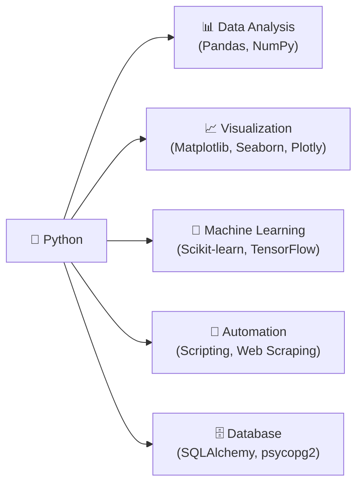
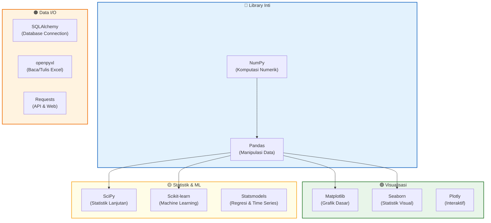

# 📘 Modul 01: Pengenalan Python & Setup Lingkungan Kerja

---

## 🎯 Tujuan Pembelajaran
Setelah menyelesaikan modul ini, Anda diharapkan mampu:
1. Memahami **mengapa Python** menjadi bahasa utama dalam dunia Data Analytics.
2. Menginstal Python dan menyiapkan lingkungan kerja (*development environment*).
3. Menjalankan kode Python pertama di **Jupyter Notebook**, **VS Code**, dan **terminal**.
4. Memahami konsep **virtual environment** dan manajemen paket dengan `pip`.
5. Mengenal ekosistem library Python untuk Data Analyst.

---

## 1. Mengapa Python untuk Data Analyst?

Python adalah bahasa pemrograman **serbaguna**, **mudah dipelajari**, dan menjadi **standar industri** untuk analisis data, machine learning, dan automasi.



### ⚖️ Perbandingan Python vs Alat Analisis Lainnya

| Kriteria | Python | Excel | R | SQL |
|---|---|---|---|---|
| **Skala Data** | Jutaan baris (bahkan lebih dengan Dask/Spark) | ~1 juta baris (terbatas) | Jutaan baris | Miliaran baris (di server) |
| **Automasi** | ✅ Sangat kuat | ⚠️ Terbatas (VBA) | ⚠️ Moderat | ❌ Tidak dirancang untuk automasi |
| **Visualisasi** | ✅ Fleksibel & customizable | ✅ Mudah tapi terbatas | ✅ ggplot2 sangat kuat | ❌ Tidak built-in |
| **Machine Learning** | ✅ Ekosistem terlengkap | ❌ Tidak ada | ✅ Cukup kuat | ❌ Tidak ada |
| **Kurva Belajar** | ⚠️ Perlu belajar coding | ✅ Paling mudah | ⚠️ Perlu belajar coding | ⚠️ Perlu belajar syntax |
| **Popularitas Industri** | ⭐⭐⭐⭐⭐ | ⭐⭐⭐⭐ | ⭐⭐⭐ | ⭐⭐⭐⭐⭐ |

> [!IMPORTANT]
> **Python tidak menggantikan SQL atau Excel** — mereka saling melengkapi! Seorang Data Analyst profesional menguasai ketiganya. Python unggul di **automasi**, **skala besar**, dan **analisis kompleks** yang sulit dilakukan di Excel.

---

## 2. Instalasi Python & Setup Environment

### Opsi A: Anaconda Distribution (Sangat Disarankan untuk Pemula)

Anaconda adalah distribusi Python yang sudah menyertakan 250+ library data science populer.

**Langkah Instalasi:**
1. Kunjungi [anaconda.com/download](https://www.anaconda.com/download).
2. Unduh installer untuk sistem operasi Anda (Windows/macOS/Linux).
3. Jalankan installer — centang **"Add Anaconda to PATH"** (Windows).
4. Verifikasi instalasi di terminal:
   ```bash
   conda --version
   # Output: conda 24.x.x
   
   python --version
   # Output: Python 3.12.x
   ```

### Opsi B: Python Resmi + pip

1. Unduh Python dari [python.org/downloads](https://www.python.org/downloads/).
2. Saat instalasi, **centang "Add Python to PATH"**.
3. Instal library yang dibutuhkan:
   ```bash
   pip install numpy pandas matplotlib seaborn jupyter scipy openpyxl
   ```

### Opsi C: Google Colab (Tanpa Instalasi)

- Buka [colab.research.google.com](https://colab.research.google.com).
- Login dengan akun Google — semua library sudah terinstal.
- Cocok untuk belajar cepat tanpa konfigurasi lokal.

---

## 3. Mengenal Editor & IDE untuk Python

### 3.1 Jupyter Notebook / JupyterLab

Jupyter Notebook adalah standar industri untuk analisis data interaktif. Kode dieksekusi per **cell** (blok), memungkinkan eksplorasi data secara bertahap.

**Menjalankan Jupyter:**
```bash
# Dari Anaconda
jupyter notebook

# Atau JupyterLab (versi modern)
jupyter lab
```

**Anatomi Jupyter Notebook:**
```
┌──────────────────────────────────────────────────┐
│  📓 Notebook (.ipynb)                            │
│                                                  │
│  [Cell 1 - Markdown]  Judul & penjelasan         │
│  [Cell 2 - Code]      import pandas as pd        │
│  [Cell 3 - Code]      df = pd.read_csv(...)      │
│  [Cell 4 - Output]    Tabel data ditampilkan      │
│  [Cell 5 - Code]      df.plot(kind='bar')        │
│  [Cell 6 - Output]    📊 Grafik ditampilkan       │
└──────────────────────────────────────────────────┘
```

**Shortcut Penting Jupyter:**
| Shortcut | Fungsi |
|---|---|
| `Shift + Enter` | Jalankan cell & pindah ke cell berikutnya |
| `Ctrl + Enter` | Jalankan cell (tetap di cell saat ini) |
| `A` (command mode) | Tambahkan cell di atas |
| `B` (command mode) | Tambahkan cell di bawah |
| `DD` (command mode) | Hapus cell |
| `M` (command mode) | Ubah cell ke Markdown |
| `Y` (command mode) | Ubah cell ke Code |
| `Esc` | Masuk command mode |
| `Enter` | Masuk edit mode |

### 3.2 Visual Studio Code (VS Code)

VS Code adalah editor serbaguna yang sangat populer:
1. Instal [VS Code](https://code.visualstudio.com/).
2. Instal ekstensi: **Python** (Microsoft) dan **Jupyter** (Microsoft).
3. Buat file `.py` atau `.ipynb` dan mulai coding.

---

## 4. Virtual Environment (Isolasi Proyek)

Virtual environment memisahkan library antar proyek sehingga tidak saling bentrok.

```bash
# Membuat virtual environment
python -m venv nama_env

# Mengaktifkan (Windows)
nama_env\Scripts\activate

# Mengaktifkan (macOS/Linux)
source nama_env/bin/activate

# Menginstal library di dalam environment
pip install pandas numpy matplotlib

# Melihat library yang terinstal
pip list

# Menyimpan daftar library ke file
pip freeze > requirements.txt

# Menginstal dari requirements.txt (di environment lain)
pip install -r requirements.txt

# Menonaktifkan environment
deactivate
```

> [!TIP]
> Dengan **Anaconda**, Anda bisa menggunakan `conda create` sebagai alternatif:
> ```bash
> conda create -n data_analyst python=3.12 pandas numpy matplotlib seaborn
> conda activate data_analyst
> ```

---

## 5. Ekosistem Library Python untuk Data Analyst



| Library | Kegunaan | Contoh Penggunaan |
|---|---|---|
| **NumPy** | Array multi-dimensi, operasi matematika cepat | `np.mean(data)`, `np.array([1,2,3])` |
| **Pandas** | Membaca, memanipulasi, dan menganalisis data tabular | `pd.read_csv()`, `df.groupby()` |
| **Matplotlib** | Membuat grafik dasar (line, bar, scatter, pie) | `plt.plot()`, `plt.bar()` |
| **Seaborn** | Visualisasi statistik yang indah di atas Matplotlib | `sns.heatmap()`, `sns.boxplot()` |
| **SciPy** | Uji statistik (t-test, chi-square, korelasi) | `stats.ttest_ind()` |
| **openpyxl** | Membaca/menulis file Excel (.xlsx) | `pd.read_excel()` |

---

## 6. Program Python Pertama Anda

### 6.1 Hello, Data Analyst!

```python
# Program pertama
print("Hello, Data Analyst! 🐍📊")

# Operasi aritmatika sederhana
revenue = 150_000_000  # Revenue bulan ini (Rp)
cost = 95_000_000      # Total biaya (Rp)
profit = revenue - cost

print(f"Revenue  : Rp {revenue:,.0f}")
print(f"Cost     : Rp {cost:,.0f}")
print(f"Profit   : Rp {profit:,.0f}")
print(f"Margin   : {(profit / revenue) * 100:.1f}%")
```

**Output:**
```
Hello, Data Analyst! 🐍📊
Revenue  : Rp 150,000,000
Cost     : Rp 95,000,000
Profit   : Rp 55,000,000
Margin   : 36.7%
```

### 6.2 Membaca Data Pertama dengan Pandas

```python
import pandas as pd

# Membaca file CSV
df = pd.read_csv("data_penjualan.csv")

# Melihat 5 baris pertama
print(df.head())

# Informasi struktur data
print(df.info())

# Ringkasan statistik
print(df.describe())
```

---

## 🧪 Latihan Mandiri 01

### Tugas:
1. **Instal Python** (Anaconda atau python.org) di komputer Anda.
2. **Buka Jupyter Notebook** dan buat notebook baru.
3. **Jalankan kode berikut** di cell pertama:
   ```python
   import sys
   import platform
   
   print(f"Python Version : {sys.version}")
   print(f"Platform       : {platform.system()} {platform.release()}")
   print(f"Machine        : {platform.machine()}")
   print("✅ Python siap digunakan untuk Data Analysis!")
   ```
4. **Hitung metrik bisnis** berikut di cell kedua:
   - Total penjualan Q1 = Rp 45.000.000, Q2 = Rp 52.000.000, Q3 = Rp 48.500.000, Q4 = Rp 61.200.000
   - Hitung: total tahunan, rata-rata per kuartal, dan pertumbuhan Q4 vs Q1 dalam persen.
5. **Simpan notebook** dengan nama `01_latihan_setup.ipynb`.

---

## ⏭️ Langkah Selanjutnya
Setelah lingkungan kerja siap, lanjutkan ke fondasi bahasa Python:  
👉 **[Modul 02: Variabel, Tipe Data & Operator](02_Variabel_Tipe_Data_dan_Operator.md)**
