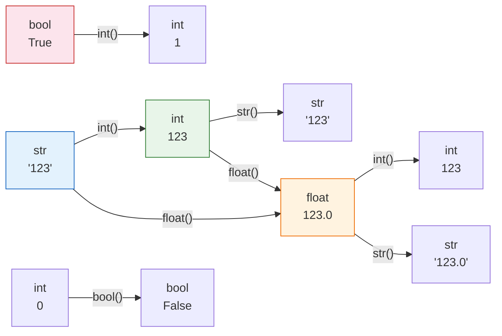

# 📘 Modul 02: Variabel, Tipe Data & Operator

---

## 🎯 Tujuan Pembelajaran
Setelah menyelesaikan modul ini, Anda diharapkan mampu:
1. Mendeklarasikan **variabel** dan memahami aturan penamaan (*naming convention*).
2. Menguasai semua **tipe data primitif** Python: `int`, `float`, `str`, `bool`, `None`.
3. Melakukan **type casting** (konversi tipe data) dengan benar.
4. Menggunakan **operator** aritmatika, perbandingan, logika, dan assignment.
5. Menggunakan **f-string** untuk format output yang profesional.

---

## 1. Variabel: Wadah Penyimpan Data

Variabel adalah **nama** yang merujuk ke sebuah **nilai** yang tersimpan di memori komputer.

```python
# Deklarasi variabel — Python tidak perlu menentukan tipe secara eksplisit
nama_produk = "Laptop ASUS ROG"      # str (teks/string)
harga = 18_500_000                    # int (bilangan bulat)
diskon_persen = 12.5                  # float (bilangan desimal)
tersedia = True                       # bool (boolean)
catatan = None                        # NoneType (tidak ada nilai)

print(nama_produk)
print(type(harga))  # <class 'int'>
```

### 📏 Aturan Penamaan Variabel

| Aturan | Contoh Benar ✅ | Contoh Salah ❌ |
|---|---|---|
| Harus diawali huruf atau `_` | `total_revenue`, `_private` | `2nd_quarter`, `@data` |
| Hanya boleh huruf, angka, `_` | `sales_q1`, `item_2024` | `total-revenue`, `data!clean` |
| Case-sensitive | `Revenue` ≠ `revenue` | — |
| Tidak boleh keyword Python | `total`, `margin` | `class`, `return`, `import` |

### 🐍 Konvensi Penamaan (PEP 8 Style Guide)

```python
# ✅ snake_case untuk variabel dan fungsi (standar Python)
total_revenue = 500_000_000
average_order_value = 125_000

# ✅ UPPER_CASE untuk konstanta
TAX_RATE = 0.11
MAX_RETRY = 3

# ✅ PascalCase untuk nama class
class SalesReport:
    pass

# ❌ Hindari singkatan yang tidak jelas
tr = 500_000  # Apa itu 'tr'? Tidak jelas!
```

---

## 2. Tipe Data Primitif

Python memiliki beberapa tipe data dasar yang sangat penting:

### 2.1 Integer (`int`) — Bilangan Bulat

```python
jumlah_transaksi = 1_250       # Underscore sebagai separator ribuan (readability)
jumlah_negatif = -50
jumlah_besar = 10**18          # Python mendukung integer tak terbatas

print(type(jumlah_transaksi))  # <class 'int'>
```

### 2.2 Float (`float`) — Bilangan Desimal

```python
rata_rata_penjualan = 3_450_750.85
pi = 3.14159
notasi_ilmiah = 1.5e6          # 1,500,000.0

print(type(rata_rata_penjualan))  # <class 'float'>

# ⚠️ Hati-hati: Float memiliki keterbatasan presisi!
print(0.1 + 0.2)               # 0.30000000000000004 (bukan 0.3!)
print(0.1 + 0.2 == 0.3)        # False!

# Solusi: gunakan round() atau library decimal
print(round(0.1 + 0.2, 1))     # 0.3
```

### 2.3 String (`str`) — Teks

```python
nama = "Budi Santoso"
alamat = 'Jl. Sudirman No. 45'
deskripsi = """Ini adalah string
multi-baris yang sangat berguna
untuk teks panjang."""

# Operasi string
print(nama.upper())          # "BUDI SANTOSO"
print(nama.lower())          # "budi santoso"
print(nama.title())          # "Budi Santoso"
print(nama.replace("Budi", "Andi"))  # "Andi Santoso"
print(len(nama))             # 13

# Slicing (mengambil sebagian teks)
print(nama[0])               # "B"  (indeks mulai dari 0)
print(nama[0:4])             # "Budi"
print(nama[-7:])             # "Santoso"

# String Methods yang Sering Digunakan Data Analyst
data_kotor = "  Jakarta Selatan  "
print(data_kotor.strip())     # "Jakarta Selatan" (hapus spasi di ujung)
print("Jakarta" in nama)      # False (cek apakah substring ada)

csv_line = "produk,harga,qty"
kolom = csv_line.split(",")   # ['produk', 'harga', 'qty']
print(kolom)
```

### 2.4 Boolean (`bool`) — Nilai Logika

```python
is_active = True
has_discount = False

print(type(is_active))        # <class 'bool'>

# Boolean sering dihasilkan dari perbandingan
revenue = 150_000_000
target = 100_000_000
target_tercapai = revenue >= target
print(target_tercapai)         # True

# Konversi ke bool (Truthy & Falsy)
print(bool(0))      # False
print(bool(""))     # False
print(bool(None))   # False
print(bool([]))     # False
print(bool(1))      # True
print(bool("data")) # True
print(bool([1,2]))  # True
```

### 2.5 NoneType (`None`) — Ketiadaan Nilai

```python
# None menandakan tidak ada nilai (bukan 0, bukan "", bukan False)
hasil_analisis = None

if hasil_analisis is None:
    print("Analisis belum dilakukan.")

# None vs 0 vs "" vs False
print(None == 0)        # False
print(None == "")       # False
print(None == False)    # False
print(None is None)     # True ✅ (gunakan 'is' untuk cek None)
```

---

## 3. Type Casting (Konversi Tipe Data)

Konversi tipe data sangat penting saat membersihkan data!

```python
# String ke Integer/Float
harga_str = "25000"
harga_int = int(harga_str)          # 25000
harga_float = float(harga_str)      # 25000.0

# Integer/Float ke String
jumlah = 42
jumlah_str = str(jumlah)            # "42"

# Float ke Integer (memotong desimal, BUKAN membulatkan)
nilai = 3.7
print(int(nilai))                    # 3 (bukan 4!)
print(round(nilai))                  # 4 (pembulatan)

# ⚠️ Kasus umum di Data Analysis:
data_csv = "Rp 15.000.000"
# Harus bersihkan dulu sebelum konversi!
angka_bersih = data_csv.replace("Rp ", "").replace(".", "")
harga_final = int(angka_bersih)      # 15000000
print(harga_final)
```



---

## 4. Operator

### 4.1 Operator Aritmatika

```python
a, b = 17, 5

print(a + b)     # 22   (Penjumlahan)
print(a - b)     # 12   (Pengurangan)
print(a * b)     # 85   (Perkalian)
print(a / b)     # 3.4  (Pembagian — selalu menghasilkan float)
print(a // b)    # 3    (Pembagian bulat / floor division)
print(a % b)     # 2    (Modulo / sisa bagi)
print(a ** b)    # 1419857 (Pangkat: 17^5)
```

### 4.2 Operator Perbandingan

```python
x, y = 100, 200

print(x == y)    # False  (Sama dengan)
print(x != y)    # True   (Tidak sama dengan)
print(x > y)     # False  (Lebih besar)
print(x < y)     # True   (Lebih kecil)
print(x >= 100)  # True   (Lebih besar atau sama)
print(x <= 99)   # False  (Lebih kecil atau sama)
```

### 4.3 Operator Logika

```python
revenue = 150_000_000
profit_margin = 0.35
customer_count = 500

# AND — Kedua kondisi harus True
high_performer = revenue > 100_000_000 and profit_margin > 0.30
print(high_performer)  # True

# OR — Salah satu kondisi True sudah cukup
needs_attention = revenue < 50_000_000 or customer_count < 100
print(needs_attention)  # False

# NOT — Membalik nilai boolean
is_loss = profit_margin < 0
print(not is_loss)     # True (bukan rugi = untung)
```

### 4.4 Operator Assignment Gabungan

```python
total = 0

total += 100     # total = total + 100  → 100
total -= 20      # total = total - 20   → 80
total *= 3       # total = total * 3    → 240
total //= 7      # total = total // 7   → 34

print(total)     # 34
```

---

## 5. F-String: Format Output Profesional

F-string (format string) adalah cara modern dan paling mudah untuk memformat output di Python 3.6+.

```python
# Dasar f-string
nama = "Andi"
jabatan = "Data Analyst"
print(f"Halo, saya {nama}, seorang {jabatan}.")

# Format angka
revenue = 1_450_000_000
growth = 0.2345
items = 42

print(f"Revenue     : Rp {revenue:,.0f}")           # Rp 1,450,000,000
print(f"Revenue     : Rp {revenue:>20,.0f}")         # Rata kanan, lebar 20
print(f"Growth      : {growth:.2%}")                 # 23.45%
print(f"Growth      : {growth:.4f}")                 # 0.2345
print(f"Total Items : {items:05d}")                  # 00042 (padding nol)

# Ekspresi di dalam f-string
harga = 250_000
qty = 15
print(f"Total: Rp {harga * qty:,.0f}")               # Total: Rp 3,750,000

# F-string multi-line
report = f"""
{'='*50}
📊 LAPORAN PENJUALAN HARIAN
{'='*50}
Revenue   : Rp {revenue:>15,.0f}
Growth    : {growth:>15.2%}
Items Sold: {items:>15,d}
{'='*50}
"""
print(report)
```

**Output:**
```
==================================================
📊 LAPORAN PENJUALAN HARIAN
==================================================
Revenue   : Rp 1,450,000,000
Growth    :          23.45%
Items Sold:              42
==================================================
```

---

## 6. Input dari Pengguna

```python
# Input selalu mengembalikan string!
nama = input("Masukkan nama Anda: ")
umur = int(input("Masukkan umur Anda: "))    # Perlu casting ke int
gaji = float(input("Masukkan gaji Anda: "))  # Perlu casting ke float

print(f"Halo {nama}, umur {umur} tahun. Gaji: Rp {gaji:,.0f}")
```

> [!WARNING]
> `input()` selalu mengembalikan tipe `str`. Jika Anda ingin melakukan operasi matematika, **selalu lakukan type casting** terlebih dahulu (`int()` atau `float()`). Tanpa casting, operasi seperti `"5" + "3"` akan menghasilkan `"53"` (konkatenasi), bukan `8`.

---

## 🧪 Latihan Mandiri 02

### Tugas 1: Kalkulator Bisnis Sederhana
Buat program yang:
1. Meminta input: nama produk, harga beli, harga jual, dan jumlah terjual.
2. Menghitung: total pendapatan, total modal, profit, dan profit margin (%).
3. Menampilkan hasil dengan format rupiah yang rapi menggunakan f-string.

### Tugas 2: Konversi Data Kotor
Diberikan data berikut (semua dalam bentuk string):
```python
data_revenue = "Rp 2.350.000.000"
data_growth = "15,7%"
data_customers = "12.450 orang"
```
Bersihkan dan konversi masing-masing ke tipe data numerik yang tepat (`int` atau `float`).

### Tugas 3: Identifikasi Tipe Data
Tentukan tipe data yang paling tepat untuk menyimpan informasi berikut:
- Nomor ID pelanggan
- Nama pelanggan
- Total pembelian (dalam rupiah)
- Apakah pelanggan aktif
- Tanggal registrasi
- Rating kepuasan (1-5, bisa desimal)

---

## ⏭️ Langkah Selanjutnya
Setelah menguasai tipe data dasar, lanjutkan ke struktur data yang lebih kompleks:  
👉 **[Modul 03: Struktur Data — List, Dictionary, Tuple & Set](03_Struktur_Data_List_Dict_Tuple_Set.md)**
