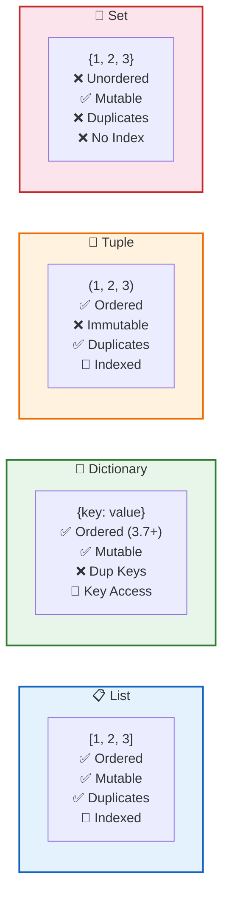

# 📘 Modul 03: Struktur Data — List, Dictionary, Tuple & Set

---

## 🎯 Tujuan Pembelajaran
Setelah menyelesaikan modul ini, Anda diharapkan mampu:
1. Memahami dan menggunakan **List** untuk menyimpan koleksi data terurut.
2. Menguasai **Dictionary** untuk menyimpan data berpasangan (key-value).
3. Mengenal **Tuple** sebagai struktur data yang tidak dapat diubah (*immutable*).
4. Menggunakan **Set** untuk operasi himpunan dan data unik.
5. Menguasai **indexing**, **slicing**, dan **list comprehension**.

---

## 1. List — Koleksi Data Terurut & Fleksibel

List adalah struktur data paling serbaguna di Python. Bisa menyimpan berbagai tipe data, bisa diubah (*mutable*), dan terurut (*ordered*).

```python
# Membuat list
penjualan_harian = [15_000_000, 22_500_000, 18_000_000, 30_200_000, 25_000_000]
nama_produk = ["Laptop", "Mouse", "Keyboard", "Monitor", "Webcam"]
campuran = ["Toko A", 1500, 25.5, True, None]  # Berbagai tipe boleh dicampur

# List kosong
data_baru = []
data_baru2 = list()
```

### 1.1 Indexing & Slicing

```
Indeks positif:   0        1         2         3         4
                ["Laptop", "Mouse", "Keyboard", "Monitor", "Webcam"]
Indeks negatif:  -5       -4        -3        -2        -1
```

```python
produk = ["Laptop", "Mouse", "Keyboard", "Monitor", "Webcam"]

# Indexing (akses satu elemen)
print(produk[0])       # "Laptop"   (elemen pertama)
print(produk[-1])      # "Webcam"   (elemen terakhir)
print(produk[-2])      # "Monitor"  (elemen kedua dari belakang)

# Slicing (akses beberapa elemen) — [start:stop:step]
print(produk[1:4])     # ["Mouse", "Keyboard", "Monitor"] (indeks 1,2,3)
print(produk[:3])      # ["Laptop", "Mouse", "Keyboard"] (dari awal)
print(produk[2:])      # ["Keyboard", "Monitor", "Webcam"] (sampai akhir)
print(produk[::2])     # ["Laptop", "Keyboard", "Webcam"] (lompat 2)
print(produk[::-1])    # ["Webcam", "Monitor", "Keyboard", "Mouse", "Laptop"] (balik)
```

### 1.2 Operasi & Metode List

```python
sales = [15, 22, 18, 30, 25]

# ➕ Menambah elemen
sales.append(28)            # Tambah di akhir → [15, 22, 18, 30, 25, 28]
sales.insert(0, 10)         # Sisipkan di indeks 0 → [10, 15, 22, 18, 30, 25, 28]
sales.extend([32, 19])      # Gabungkan list lain → [10, 15, 22, 18, 30, 25, 28, 32, 19]

# ➖ Menghapus elemen
sales.remove(18)            # Hapus nilai 18 (kemunculan pertama)
item = sales.pop()          # Hapus & ambil elemen terakhir → 19
item = sales.pop(0)         # Hapus & ambil elemen indeks 0 → 10
del sales[1]                # Hapus elemen indeks 1

# 🔍 Pencarian & Informasi
print(len(sales))           # Jumlah elemen
print(max(sales))           # Nilai terbesar
print(min(sales))           # Nilai terkecil
print(sum(sales))           # Total jumlah
print(sales.count(22))      # Hitung kemunculan nilai 22
print(sales.index(30))      # Cari indeks nilai 30
print(22 in sales)          # True (cek keberadaan)

# 🔄 Pengurutan
sales.sort()                # Urutkan ascending (in-place)
sales.sort(reverse=True)    # Urutkan descending (in-place)
sorted_sales = sorted(sales)  # Mengembalikan list baru (tidak mengubah asli)
sales.reverse()             # Balik urutan (in-place)

# 📋 Salin list
copy_sales = sales.copy()   # Shallow copy
copy_sales2 = sales[:]      # Shallow copy alternatif
```

### 1.3 List Comprehension ⭐

List comprehension adalah cara **Pythonic** dan efisien untuk membuat list baru dari list yang ada.

```python
# ❌ Cara konvensional (verbose)
harga_diskon = []
harga_list = [100_000, 250_000, 75_000, 500_000, 180_000]
for harga in harga_list:
    harga_diskon.append(harga * 0.8)  # diskon 20%

# ✅ List Comprehension (ringkas & cepat)
harga_diskon = [harga * 0.8 for harga in harga_list]
print(harga_diskon)  # [80000.0, 200000.0, 60000.0, 400000.0, 144000.0]

# Dengan kondisi (filter)
produk_mahal = [harga for harga in harga_list if harga > 150_000]
print(produk_mahal)  # [250000, 500000, 180000]

# Dengan if-else
kategori = ["Mahal" if h > 200_000 else "Murah" for h in harga_list]
print(kategori)  # ['Murah', 'Mahal', 'Murah', 'Mahal', 'Murah']

# Nested loop dalam comprehension
matrix = [[i * j for j in range(1, 4)] for i in range(1, 4)]
print(matrix)  # [[1, 2, 3], [4, 5, 6], [7, 8, 9]]
```

> [!TIP]
> **Untuk Data Analyst:** List comprehension sangat berguna untuk membersihkan dan mentransformasi data sebelum dimasukkan ke Pandas DataFrame!

---

## 2. Dictionary — Data Berpasangan (Key-Value)

Dictionary menyimpan data dalam pasangan **kunci:nilai** (*key:value*). Sangat berguna untuk menyimpan data terstruktur seperti record/row data.

```python
# Membuat dictionary
produk = {
    "nama": "Laptop ASUS ROG",
    "harga": 18_500_000,
    "stok": 45,
    "kategori": "Elektronik",
    "rating": 4.8
}

# Akses nilai
print(produk["nama"])            # "Laptop ASUS ROG"
print(produk.get("warna"))       # None (aman, tidak error)
print(produk.get("warna", "N/A"))  # "N/A" (dengan default value)

# ⚠️ Perbedaan [] vs .get()
# produk["warna"]    → KeyError! (crash jika key tidak ada)
# produk.get("warna") → None (aman)
```

### 2.1 Operasi Dictionary

```python
produk = {"nama": "Mouse", "harga": 150_000, "stok": 200}

# ➕ Menambah / Mengubah
produk["brand"] = "Logitech"      # Tambah key baru
produk["harga"] = 135_000         # Update nilai
produk.update({"warna": "Hitam", "stok": 180})  # Update banyak sekaligus

# ➖ Menghapus
del produk["warna"]               # Hapus key tertentu
harga = produk.pop("harga")      # Hapus & ambil nilainya → 135000

# 🔍 Metode penting
print(produk.keys())              # dict_keys(['nama', 'stok', 'brand'])
print(produk.values())            # dict_values(['Mouse', 180, 'Logitech'])
print(produk.items())             # dict_items([('nama', 'Mouse'), ...])
print(len(produk))                # 3
print("nama" in produk)           # True (cek keberadaan key)

# 🔄 Iterasi dictionary
for key, value in produk.items():
    print(f"{key:>10}: {value}")
```

### 2.2 Nested Dictionary (Data Tabular)

```python
# Sangat mirip dengan baris data di spreadsheet/database
database_pelanggan = {
    "C001": {"nama": "Andi", "kota": "Jakarta", "total_belanja": 5_500_000},
    "C002": {"nama": "Budi", "kota": "Surabaya", "total_belanja": 3_200_000},
    "C003": {"nama": "Citra", "kota": "Bandung", "total_belanja": 8_100_000},
}

# Akses data nested
print(database_pelanggan["C001"]["nama"])       # "Andi"
print(database_pelanggan["C003"]["total_belanja"])  # 8100000

# Iterasi semua pelanggan
for id_pelanggan, data in database_pelanggan.items():
    print(f"[{id_pelanggan}] {data['nama']} - {data['kota']} - Rp {data['total_belanja']:,.0f}")
```

### 2.3 Dictionary Comprehension

```python
# Membuat dictionary dari list
produk_list = ["Laptop", "Mouse", "Keyboard"]
harga_list = [15_000_000, 150_000, 350_000]

katalog = {produk: harga for produk, harga in zip(produk_list, harga_list)}
print(katalog)
# {'Laptop': 15000000, 'Mouse': 150000, 'Keyboard': 350000}

# Dengan filter
katalog_mahal = {k: v for k, v in katalog.items() if v > 200_000}
print(katalog_mahal)
# {'Laptop': 15000000, 'Keyboard': 350000}
```

---

## 3. Tuple — Koleksi Data Tak Berubah (Immutable)

Tuple mirip list, tapi **tidak bisa diubah** setelah dibuat. Cocok untuk data yang tidak boleh berubah.

```python
# Membuat tuple
koordinat = (106.8456, -6.2088)          # Jakarta
hari_kerja = ("Senin", "Selasa", "Rabu", "Kamis", "Jumat")
rgb_merah = (255, 0, 0)

# Indexing & slicing sama seperti list
print(koordinat[0])       # 106.8456
print(hari_kerja[1:4])    # ("Selasa", "Rabu", "Kamis")

# ❌ Tuple TIDAK bisa diubah!
# koordinat[0] = 107.0    # TypeError: 'tuple' object does not support item assignment

# Tuple unpacking (sangat Pythonic!)
longitude, latitude = koordinat
print(f"Long: {longitude}, Lat: {latitude}")

# Tuple dengan satu elemen (perlu koma!)
satu_elemen = (42,)       # ✅ Tuple
bukan_tuple = (42)         # ❌ Ini integer, bukan tuple!
```

### Kapan Menggunakan Tuple vs List?

| Aspek | List `[]` | Tuple `()` |
|---|---|---|
| **Mutability** | Mutable (bisa diubah) | Immutable (tidak bisa diubah) |
| **Kecepatan** | Sedikit lebih lambat | Sedikit lebih cepat |
| **Memori** | Lebih besar | Lebih kecil |
| **Gunakan untuk** | Data yang berubah-ubah | Data konstan, koordinat, return value |
| **Sebagai dict key** | ❌ Tidak bisa | ✅ Bisa |

---

## 4. Set — Koleksi Data Unik & Operasi Himpunan

Set menyimpan elemen **unik** (tanpa duplikat), **tidak terurut**, dan mendukung operasi himpunan matematika.

```python
# Membuat set
kota_cabang = {"Jakarta", "Surabaya", "Bandung", "Jakarta", "Medan"}
print(kota_cabang)  # {'Jakarta', 'Surabaya', 'Bandung', 'Medan'} — duplikat hilang!

# Dari list (menghapus duplikat)
data_kotor = [1, 2, 3, 2, 4, 1, 5, 3]
data_unik = set(data_kotor)
print(data_unik)    # {1, 2, 3, 4, 5}
print(list(data_unik))  # Kembali ke list jika diperlukan
```

### 4.1 Operasi Himpunan

```python
pelanggan_2023 = {"Andi", "Budi", "Citra", "Dewi"}
pelanggan_2024 = {"Budi", "Citra", "Eka", "Fajar"}

# Union (gabungan) — semua pelanggan
semua = pelanggan_2023 | pelanggan_2024
# atau: pelanggan_2023.union(pelanggan_2024)
print(semua)  # {'Andi', 'Budi', 'Citra', 'Dewi', 'Eka', 'Fajar'}

# Intersection (irisan) — pelanggan yang ada di kedua tahun
loyal = pelanggan_2023 & pelanggan_2024
print(loyal)  # {'Budi', 'Citra'}

# Difference (selisih) — pelanggan yang hilang di 2024
churn = pelanggan_2023 - pelanggan_2024
print(churn)  # {'Andi', 'Dewi'}

# Symmetric difference — pelanggan yang hanya ada di salah satu tahun
unik = pelanggan_2023 ^ pelanggan_2024
print(unik)  # {'Andi', 'Dewi', 'Eka', 'Fajar'}
```

> [!IMPORTANT]
> **Untuk Data Analyst:** Set sangat berguna untuk:
> - Menemukan **nilai unik** dalam dataset (alternatif `df['kolom'].unique()`)
> - Membandingkan **dua kelompok** (misal: pelanggan lama vs baru)
> - Menghapus **duplikat** dengan cepat
> - Mengecek **keanggotaan** (`in`) dengan performa O(1) — jauh lebih cepat dari list!

---

## 5. Perbandingan Semua Struktur Data



| Fitur | List `[]` | Dict `{}` | Tuple `()` | Set `{}` |
|---|:---:|:---:|:---:|:---:|
| **Ordered** | ✅ | ✅ (Python 3.7+) | ✅ | ❌ |
| **Mutable** | ✅ | ✅ | ❌ | ✅ |
| **Duplicates** | ✅ | ❌ (key unik) | ✅ | ❌ |
| **Indexed** | ✅ | 🔑 (by key) | ✅ | ❌ |
| **Kapan pakai** | Koleksi umum | Key-value data | Data konstan | Data unik |

---

## 🧪 Latihan Mandiri 03

### Tugas 1: Analisis Data Penjualan
Diberikan data berikut:
```python
penjualan_mingguan = [
    {"hari": "Senin", "revenue": 12_500_000, "transaksi": 45},
    {"hari": "Selasa", "revenue": 15_200_000, "transaksi": 52},
    {"hari": "Rabu", "revenue": 11_800_000, "transaksi": 38},
    {"hari": "Kamis", "revenue": 18_900_000, "transaksi": 61},
    {"hari": "Jumat", "revenue": 22_300_000, "transaksi": 73},
    {"hari": "Sabtu", "revenue": 28_500_000, "transaksi": 95},
    {"hari": "Minggu", "revenue": 25_100_000, "transaksi": 82},
]
```
Hitung: total revenue mingguan, rata-rata revenue harian, hari dengan revenue tertinggi, dan rata-rata nilai per transaksi.

### Tugas 2: Operasi Set — Analisis Pelanggan
```python
pelanggan_jan = {"A001", "A002", "A003", "A004", "A005"}
pelanggan_feb = {"A003", "A004", "A006", "A007"}
pelanggan_mar = {"A001", "A004", "A006", "A008", "A009"}
```
Temukan: pelanggan yang aktif di semua bulan, pelanggan baru di Maret, dan pelanggan yang churn setelah Januari.

### Tugas 3: List Comprehension Challenge
Dari list `range(1, 101)`, gunakan list comprehension untuk:
1. Ambil semua bilangan genap.
2. Ambil semua bilangan yang habis dibagi 3 DAN 5.
3. Buat list string "Fizz" (kelipatan 3), "Buzz" (kelipatan 5), "FizzBuzz" (kelipatan keduanya), atau angkanya sendiri.

---

## ⏭️ Langkah Selanjutnya
Setelah menguasai struktur data, lanjutkan ke pengambilan keputusan dan pengulangan:  
👉 **[Modul 04: Control Flow & Fungsi](04_Control_Flow_dan_Fungsi.md)**
