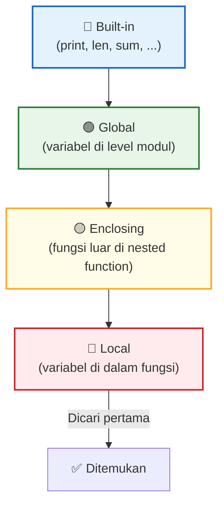

# 📘 Modul 04: Control Flow & Fungsi

---

## 🎯 Tujuan Pembelajaran
Setelah menyelesaikan modul ini, Anda diharapkan mampu:
1. Menggunakan **percabangan** (`if/elif/else`) untuk pengambilan keputusan.
2. Menguasai **perulangan** (`for`, `while`) untuk iterasi data.
3. Mengontrol alur loop dengan `break`, `continue`, dan `pass`.
4. Membuat **fungsi** (`def`) untuk kode yang reusable dan terstruktur.
5. Menggunakan **lambda**, `*args`, `**kwargs`, dan memahami scope variabel.

---

## 1. Percabangan (Conditional Statements)

### 1.1 if / elif / else

```python
revenue = 150_000_000
target = 120_000_000

# Percabangan sederhana
if revenue >= target:
    print("✅ Target tercapai!")
elif revenue >= target * 0.8:
    print("⚠️ Hampir tercapai (≥ 80% target)")
else:
    print("❌ Target belum tercapai")

# Menghitung achievement level
achievement = revenue / target * 100

if achievement >= 120:
    grade = "S (Superstar)"
elif achievement >= 100:
    grade = "A (Excellent)"
elif achievement >= 80:
    grade = "B (Good)"
elif achievement >= 60:
    grade = "C (Needs Improvement)"
else:
    grade = "D (Underperform)"

print(f"Achievement: {achievement:.1f}% → Grade: {grade}")
```

### 1.2 Ternary Operator (Conditional Expression)

```python
# Satu baris if-else (sangat Pythonic!)
revenue = 150_000_000
target = 120_000_000

status = "Tercapai ✅" if revenue >= target else "Belum ❌"
print(f"Status target: {status}")

# Contoh di Data Analysis
nilai = -5
nilai_bersih = max(nilai, 0)  # Alternatif: menghilangkan nilai negatif
label = "Profit" if nilai > 0 else ("Break Even" if nilai == 0 else "Loss")
```

### 1.3 Multiple Conditions

```python
# AND, OR, NOT
umur = 28
pengalaman = 3
skill_python = True

# Kandidat diterima jika memenuhi semua kriteria
if umur >= 22 and pengalaman >= 2 and skill_python:
    print("✅ Kandidat memenuhi syarat")

# Minimal salah satu sertifikasi
has_pbi = False
has_tableau = True
has_looker = False

if has_pbi or has_tableau or has_looker:
    print("✅ Memiliki minimal satu sertifikasi BI")

# Operator 'in' untuk cek keanggotaan
kota = "Surabaya"
kota_valid = ["Jakarta", "Surabaya", "Bandung", "Medan", "Semarang"]

if kota in kota_valid:
    print(f"✅ {kota} adalah kota yang dilayani")
```

---

## 2. Perulangan (Loops)

### 2.1 For Loop

```python
# Iterasi list
produk_list = ["Laptop", "Mouse", "Keyboard", "Monitor"]
for produk in produk_list:
    print(f"Produk: {produk}")

# range() — menghasilkan urutan angka
for i in range(5):           # 0, 1, 2, 3, 4
    print(i, end=" ")

for i in range(1, 6):        # 1, 2, 3, 4, 5
    print(i, end=" ")

for i in range(0, 10, 2):    # 0, 2, 4, 6, 8 (step 2)
    print(i, end=" ")

# enumerate() — iterasi dengan indeks ⭐
bulan = ["Jan", "Feb", "Mar", "Apr", "Mei"]
for idx, nama_bulan in enumerate(bulan, start=1):
    print(f"Bulan ke-{idx}: {nama_bulan}")

# zip() — iterasi paralel dari beberapa list ⭐
nama = ["Andi", "Budi", "Citra"]
score = [85, 92, 78]
grade = ["B+", "A", "B"]

for n, s, g in zip(nama, score, grade):
    print(f"{n}: Score {s} → Grade {g}")
```

### 2.2 Iterasi Dictionary

```python
sales_data = {
    "Q1": 45_000_000,
    "Q2": 52_000_000,
    "Q3": 48_500_000,
    "Q4": 61_200_000
}

# Iterasi key saja
for quarter in sales_data:
    print(quarter)

# Iterasi key dan value
for quarter, revenue in sales_data.items():
    status = "📈" if revenue > 50_000_000 else "📉"
    print(f"{quarter}: Rp {revenue:>12,.0f} {status}")

# Output:
# Q1: Rp   45,000,000 📉
# Q2: Rp   52,000,000 📈
# Q3: Rp   48,500,000 📉
# Q4: Rp   61,200,000 📈
```

### 2.3 While Loop

```python
# While loop — ulangi selama kondisi True
saldo = 1_000_000
bulan = 0
bunga_bulanan = 0.005  # 0.5% per bulan

while saldo < 2_000_000:
    saldo *= (1 + bunga_bulanan)
    bulan += 1

print(f"Saldo mencapai Rp 2 juta setelah {bulan} bulan")
print(f"Saldo akhir: Rp {saldo:,.0f}")
```

### 2.4 Break, Continue, Pass

```python
# break — menghentikan loop sepenuhnya
data = [10, 25, -5, 30, 15, -3, 20]
for nilai in data:
    if nilai < 0:
        print(f"⚠️ Ditemukan nilai negatif: {nilai}. Hentikan proses!")
        break
    print(f"Memproses: {nilai}")

# continue — lewati iterasi saat ini, lanjut ke berikutnya
for nilai in data:
    if nilai < 0:
        continue  # Lewati nilai negatif
    print(f"Nilai valid: {nilai}")

# pass — placeholder (tidak melakukan apa-apa)
for nilai in data:
    if nilai < 0:
        pass  # TODO: handle nanti
    else:
        print(f"OK: {nilai}")
```

### 2.5 Nested Loop

```python
# Contoh: Laporan penjualan per cabang per kuartal
cabang = ["Jakarta", "Surabaya", "Bandung"]
kuartal = ["Q1", "Q2", "Q3", "Q4"]

print(f"{'Cabang':<12}", end="")
for q in kuartal:
    print(f"{q:>10}", end="")
print()
print("-" * 52)

import random
for c in cabang:
    print(f"{c:<12}", end="")
    for q in kuartal:
        revenue = random.randint(30, 80) * 1_000_000
        print(f"{revenue:>10,.0f}", end="")
    print()
```

---

## 3. Fungsi (Functions)

### 3.1 Membuat Fungsi Dasar

```python
# Fungsi tanpa parameter
def tampilkan_header():
    print("=" * 50)
    print("📊 LAPORAN ANALISIS DATA")
    print("=" * 50)

tampilkan_header()

# Fungsi dengan parameter dan return value
def hitung_profit_margin(revenue, cost):
    """Menghitung profit margin dari revenue dan cost."""
    profit = revenue - cost
    margin = (profit / revenue) * 100
    return margin

margin = hitung_profit_margin(150_000_000, 95_000_000)
print(f"Profit Margin: {margin:.2f}%")  # 36.67%
```

### 3.2 Default Parameter & Keyword Arguments

```python
def format_rupiah(nominal, desimal=0, prefix="Rp"):
    """Format angka menjadi string rupiah."""
    return f"{prefix} {nominal:,.{desimal}f}"

print(format_rupiah(15000000))              # Rp 15,000,000
print(format_rupiah(15000000, desimal=2))   # Rp 15,000,000.00
print(format_rupiah(1500, prefix="USD"))    # USD 1,500

# Keyword arguments (urutan bebas)
print(format_rupiah(prefix="IDR", nominal=25_000_000, desimal=0))
```

### 3.3 Multiple Return Values

```python
def analisis_penjualan(data):
    """Mengembalikan statistik dasar dari data penjualan."""
    total = sum(data)
    rata_rata = total / len(data)
    tertinggi = max(data)
    terendah = min(data)
    return total, rata_rata, tertinggi, terendah  # Mengembalikan tuple

sales = [15, 22, 18, 30, 25, 28, 20]
total, avg, high, low = analisis_penjualan(sales)

print(f"Total    : {total}")
print(f"Rata-rata: {avg:.1f}")
print(f"Tertinggi: {high}")
print(f"Terendah : {low}")
```

### 3.4 *args dan **kwargs

```python
# *args — menerima argumen posisional tak terbatas (sebagai tuple)
def hitung_total(*angka):
    """Menghitung total dari sejumlah angka."""
    return sum(angka)

print(hitung_total(10, 20, 30))        # 60
print(hitung_total(5, 10, 15, 20, 25)) # 75

# **kwargs — menerima argumen keyword tak terbatas (sebagai dictionary)
def buat_profil(**info):
    """Membuat profil dari key-value pairs."""
    for key, value in info.items():
        print(f"{key:>12}: {value}")

buat_profil(nama="Andi", jabatan="Data Analyst", kota="Jakarta", gaji=12_000_000)

# Kombinasi keduanya
def laporan(judul, *data, **opsi):
    print(f"\n📊 {judul}")
    print(f"Data: {data}")
    for k, v in opsi.items():
        print(f"  {k}: {v}")

laporan("Sales Report", 100, 200, 300, format="PDF", author="Andi")
```

### 3.5 Lambda Functions (Fungsi Anonim)

```python
# Lambda — fungsi singkat satu baris
kuadrat = lambda x: x ** 2
print(kuadrat(5))  # 25

# Lambda sering digunakan dengan sorted(), map(), filter()
produk = [
    {"nama": "Laptop", "harga": 15_000_000},
    {"nama": "Mouse", "harga": 150_000},
    {"nama": "Monitor", "harga": 3_500_000},
    {"nama": "Keyboard", "harga": 350_000},
]

# Sort berdasarkan harga (ascending)
produk_sorted = sorted(produk, key=lambda x: x["harga"])
for p in produk_sorted:
    print(f"{p['nama']:>10}: Rp {p['harga']:>12,.0f}")

# filter() — filter data
harga_list = [150_000, 15_000_000, 350_000, 3_500_000, 75_000]
mahal = list(filter(lambda x: x > 1_000_000, harga_list))
print(mahal)  # [15000000, 3500000]

# map() — transformasi data
harga_diskon = list(map(lambda x: x * 0.9, harga_list))
print(harga_diskon)
```

---

## 4. Scope Variabel (LEGB Rule)

```python
# Python mencari variabel dalam urutan: Local → Enclosing → Global → Built-in

x = "global"  # Global scope

def outer():
    x = "enclosing"  # Enclosing scope
    
    def inner():
        x = "local"  # Local scope
        print(f"Inner: {x}")  # "local"
    
    inner()
    print(f"Outer: {x}")  # "enclosing"

outer()
print(f"Global: {x}")  # "global"
```



---

## 5. Error Handling (Try/Except)

```python
# Menangani error agar program tidak crash
def safe_divide(a, b):
    """Pembagian aman dengan error handling."""
    try:
        result = a / b
    except ZeroDivisionError:
        print("⚠️ Error: Pembagian dengan nol!")
        return None
    except TypeError:
        print("⚠️ Error: Tipe data tidak valid!")
        return None
    else:
        return result
    finally:
        print("Operasi pembagian selesai.")

print(safe_divide(100, 5))    # 20.0
print(safe_divide(100, 0))    # None (dengan pesan error)
print(safe_divide("100", 5))  # None (dengan pesan error)

# Contoh di Data Analysis: membaca file dengan aman
def baca_data(filepath):
    """Membaca file CSV dengan error handling."""
    try:
        import pandas as pd
        df = pd.read_csv(filepath)
        print(f"✅ Berhasil membaca {len(df)} baris dari {filepath}")
        return df
    except FileNotFoundError:
        print(f"❌ File tidak ditemukan: {filepath}")
        return None
    except Exception as e:
        print(f"❌ Error tidak terduga: {e}")
        return None
```

---

## 🧪 Latihan Mandiri 04

### Tugas 1: Sistem Grading Otomatis
Buat fungsi `tentukan_grade(skor)` yang menerima skor (0-100) dan mengembalikan:
- A (≥ 85), B (≥ 70), C (≥ 55), D (≥ 40), E (< 40)
- Validasi input: jika skor di luar 0-100, kembalikan "Invalid"

### Tugas 2: Analisis Data dengan Fungsi
Buat fungsi `ringkasan_statistik(data)` yang menerima list angka dan mengembalikan dictionary berisi:
- `count`, `sum`, `mean`, `median`, `min`, `max`, `range`, `std_dev`

### Tugas 3: Data Cleaning Pipeline
Buat fungsi `bersihkan_harga(harga_list)` yang menerima list string harga kotor seperti:
```python
harga_kotor = ["Rp 15.000", "25000", "Rp. 8.500", "12,500", "FREE", "Rp100000", "-"]
```
Dan mengembalikan list integer yang sudah bersih, dengan menangani semua format dan memfilter yang tidak valid.

---

## ⏭️ Langkah Selanjutnya
Setelah menguasai fondasi Python, saatnya masuk ke library utama Data Science:  
👉 **[Modul 05: NumPy — Fondasi Komputasi Numerik](05_NumPy_Komputasi_Numerik.md)**
