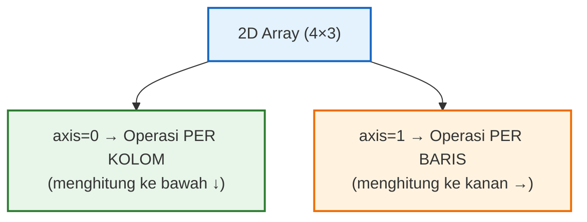

# 📘 Modul 05: NumPy — Fondasi Komputasi Numerik

---

## 🎯 Tujuan Pembelajaran
Setelah menyelesaikan modul ini, Anda diharapkan mampu:
1. Memahami **mengapa NumPy** sangat penting untuk Data Analysis.
2. Membuat dan memanipulasi **ndarray** (N-dimensional array).
3. Melakukan **operasi vektorisasi** yang jauh lebih cepat dari loop Python biasa.
4. Menguasai **indexing**, **slicing**, dan **boolean indexing** pada array.
5. Menggunakan fungsi **statistik**, **matematika**, dan **random** NumPy.

---

## 1. Mengapa NumPy?

NumPy (Numerical Python) adalah fondasi dari hampir semua library data science di Python. Pandas, Matplotlib, Scikit-learn — semua dibangun di atas NumPy.

### ⚡ Kecepatan: NumPy vs Python List

```python
import numpy as np
import time

# Perbandingan kecepatan: kuadrat 1 juta elemen
size = 1_000_000
python_list = list(range(size))
numpy_array = np.arange(size)

# Python list (loop)
start = time.time()
result_list = [x ** 2 for x in python_list]
time_list = time.time() - start

# NumPy (vectorized)
start = time.time()
result_numpy = numpy_array ** 2
time_numpy = time.time() - start

print(f"Python List : {time_list:.4f} detik")
print(f"NumPy Array : {time_numpy:.4f} detik")
print(f"NumPy {time_list / time_numpy:.0f}x lebih cepat! 🚀")
```

> [!IMPORTANT]
> NumPy bisa **10-100x lebih cepat** dari Python list biasa karena:
> 1. **Tipe data homogen** — semua elemen bertipe sama, disimpan secara kontinu di memori.
> 2. **Operasi vektorisasi** — dihitung di level C, bukan loop Python.
> 3. **Broadcasting** — operasi antar array berbeda ukuran tanpa loop eksplisit.

---

## 2. Membuat Array (ndarray)

```python
import numpy as np

# Dari list Python
arr1d = np.array([10, 20, 30, 40, 50])
arr2d = np.array([[1, 2, 3],
                   [4, 5, 6],
                   [7, 8, 9]])

print(arr1d)          # [10 20 30 40 50]
print(arr2d)
print(arr1d.dtype)    # int64 (tipe data otomatis)
print(arr2d.shape)    # (3, 3) — 3 baris, 3 kolom
print(arr2d.ndim)     # 2 (dimensi)
print(arr2d.size)     # 9 (total elemen)

# Menentukan tipe data
arr_float = np.array([1, 2, 3], dtype=np.float64)
print(arr_float)      # [1. 2. 3.]
```

### Fungsi Pembuat Array Cepat

```python
# Array dengan nilai tetap
zeros = np.zeros((3, 4))          # 3x4 array berisi 0
ones = np.ones((2, 3))            # 2x3 array berisi 1
full = np.full((2, 2), 7)         # 2x2 array berisi 7
empty = np.empty((3, 3))          # 3x3 array (isi acak/sisa memori)

# Urutan angka
arange = np.arange(0, 10, 2)      # [0, 2, 4, 6, 8] (mirip range)
linspace = np.linspace(0, 1, 5)   # [0. , 0.25, 0.5 , 0.75, 1. ] (5 titik merata)

# Matriks identitas
eye = np.eye(3)                    # Matriks identitas 3x3

# Array acak
random_int = np.random.randint(1, 100, size=(3, 4))    # 3x4 integer acak 1-99
random_float = np.random.random((2, 3))                # 2x3 float acak 0-1
random_normal = np.random.normal(loc=50, scale=10, size=1000)  # Distribusi normal
```

---

## 3. Indexing & Slicing

### 3.1 Array 1D

```python
arr = np.array([10, 20, 30, 40, 50, 60, 70, 80, 90, 100])

print(arr[0])       # 10 (elemen pertama)
print(arr[-1])      # 100 (elemen terakhir)
print(arr[2:6])     # [30 40 50 60] (indeks 2-5)
print(arr[:5])      # [10 20 30 40 50]
print(arr[::2])     # [10 30 50 70 90] (lompat 2)
print(arr[::-1])    # [100 90 80 ... 10] (balik)
```

### 3.2 Array 2D

```python
matrix = np.array([[1, 2, 3, 4],
                    [5, 6, 7, 8],
                    [9, 10, 11, 12]])

print(matrix[0, 0])      # 1  (baris 0, kolom 0)
print(matrix[1, 2])      # 7  (baris 1, kolom 2)
print(matrix[0])          # [1 2 3 4] (seluruh baris 0)
print(matrix[:, 1])       # [2 6 10] (seluruh kolom 1)
print(matrix[0:2, 1:3])   # [[2 3] [6 7]] (sub-matrix)
print(matrix[:, -1])       # [4 8 12] (kolom terakhir)
```

### 3.3 Boolean Indexing (Sangat Penting untuk Data Analysis!) ⭐

```python
penjualan = np.array([45, 72, 38, 91, 55, 23, 67, 84, 49, 76])

# Filter: penjualan di atas 60
mask = penjualan > 60
print(mask)
# [False  True False  True False False  True  True False  True]

print(penjualan[mask])           # [72 91 67 84 76]
print(penjualan[penjualan > 60]) # Sama — lebih ringkas

# Kombinasi kondisi (gunakan & untuk AND, | untuk OR, ~ untuk NOT)
filter_result = penjualan[(penjualan > 40) & (penjualan < 80)]
print(filter_result)             # [45 72 55 67 49 76]

# Mengganti nilai berdasarkan kondisi
penjualan_copy = penjualan.copy()
penjualan_copy[penjualan_copy < 50] = 50  # Minimum cap di 50
print(penjualan_copy)
# [50 72 50 91 55 50 67 84 50 76]
```

### 3.4 Fancy Indexing

```python
arr = np.array([10, 20, 30, 40, 50, 60, 70])

# Akses beberapa indeks sekaligus
indices = [0, 2, 5]
print(arr[indices])    # [10 30 60]

# Pada array 2D
matrix = np.arange(1, 13).reshape(3, 4)
print(matrix)
# [[ 1  2  3  4]
#  [ 5  6  7  8]
#  [ 9 10 11 12]]

# Ambil baris 0 dan 2
print(matrix[[0, 2]])
# [[ 1  2  3  4]
#  [ 9 10 11 12]]
```

---

## 4. Operasi Array

### 4.1 Operasi Element-wise (Vektorisasi)

```python
a = np.array([10, 20, 30, 40])
b = np.array([1, 2, 3, 4])

print(a + b)      # [11 22 33 44]
print(a - b)      # [ 9 18 27 36]
print(a * b)      # [ 10  40  90 160]
print(a / b)      # [10. 10. 10. 10.]
print(a ** 2)     # [ 100  400  900 1600]
print(np.sqrt(a)) # [3.162... 4.472... 5.477... 6.324...]

# Operasi dengan skalar (broadcasting otomatis)
harga = np.array([100_000, 250_000, 75_000, 500_000])
harga_ppn = harga * 1.11  # Tambah PPN 11%
print(harga_ppn)
# [111000. 277500.  83250. 555000.]
```

### 4.2 Broadcasting

```python
# Broadcasting: NumPy secara otomatis menyesuaikan ukuran array
matrix = np.array([[1, 2, 3],
                    [4, 5, 6],
                    [7, 8, 9]])

# Menambahkan vektor ke setiap baris
row_add = np.array([10, 20, 30])
print(matrix + row_add)
# [[11 22 33]
#  [14 25 36]
#  [17 28 39]]

# Contoh nyata: Normalisasi data per kolom
data = np.array([[170, 65],    # [tinggi, berat]
                  [160, 55],
                  [180, 80],
                  [175, 70]])

mean = data.mean(axis=0)       # Rata-rata per kolom
std = data.std(axis=0)         # Std dev per kolom
data_normalized = (data - mean) / std  # Z-score normalisasi
print(data_normalized)
```

---

## 5. Fungsi Statistik

```python
data = np.array([45, 72, 38, 91, 55, 23, 67, 84, 49, 76])

# Statistik dasar
print(f"Mean     : {np.mean(data):.2f}")       # Rata-rata
print(f"Median   : {np.median(data):.2f}")     # Nilai tengah
print(f"Std Dev  : {np.std(data):.2f}")        # Standar deviasi
print(f"Variance : {np.var(data):.2f}")        # Varians
print(f"Min      : {np.min(data)}")            # Minimum
print(f"Max      : {np.max(data)}")            # Maksimum
print(f"Sum      : {np.sum(data)}")            # Total
print(f"Range    : {np.ptp(data)}")            # Peak-to-peak (max - min)

# Percentile & Quartile
print(f"Q1 (25%) : {np.percentile(data, 25)}")
print(f"Q2 (50%) : {np.percentile(data, 50)}")  # = median
print(f"Q3 (75%) : {np.percentile(data, 75)}")

# Posisi elemen
print(f"Indeks min : {np.argmin(data)}")  # Indeks elemen terkecil
print(f"Indeks max : {np.argmax(data)}")  # Indeks elemen terbesar

# Kumulatif
print(f"Cum Sum : {np.cumsum(data)}")     # Jumlah kumulatif
print(f"Cum Prod: {np.cumprod(data[:5])}")  # Produk kumulatif

# Korelasi
x = np.array([1, 2, 3, 4, 5])
y = np.array([2, 4, 5, 4, 5])
print(f"Korelasi: {np.corrcoef(x, y)[0, 1]:.4f}")
```

### Operasi pada Axis (Baris vs Kolom)

```python
# Data: 4 cabang × 3 bulan
sales = np.array([
    [45, 52, 48],   # Cabang Jakarta
    [38, 41, 44],   # Cabang Surabaya
    [55, 60, 58],   # Cabang Bandung
    [30, 35, 33],   # Cabang Medan
])

print("Total per cabang (axis=1):", np.sum(sales, axis=1))   # [145, 123, 173, 98]
print("Total per bulan (axis=0) :", np.sum(sales, axis=0))   # [168, 188, 183]
print("Rata-rata per cabang     :", np.mean(sales, axis=1))
print("Max per bulan            :", np.max(sales, axis=0))
```



---

## 6. Reshape & Manipulasi Bentuk Array

```python
arr = np.arange(1, 13)  # [1, 2, 3, ..., 12]

# Reshape — mengubah bentuk tanpa mengubah data
matrix_3x4 = arr.reshape(3, 4)
matrix_4x3 = arr.reshape(4, 3)
matrix_2x6 = arr.reshape(2, 6)

print(matrix_3x4)
# [[ 1  2  3  4]
#  [ 5  6  7  8]
#  [ 9 10 11 12]]

# -1 sebagai placeholder (NumPy menghitung otomatis)
auto_reshape = arr.reshape(3, -1)  # 3 baris, kolom otomatis → (3, 4)
auto_reshape2 = arr.reshape(-1, 2) # Baris otomatis, 2 kolom → (6, 2)

# Transpose
print(matrix_3x4.T)       # (4, 3) — baris jadi kolom
print(matrix_3x4.T.shape) # (4, 3)

# Flatten — 2D → 1D
flat = matrix_3x4.flatten()
print(flat)  # [ 1  2  3  4  5  6  7  8  9 10 11 12]

# Stack arrays
a = np.array([1, 2, 3])
b = np.array([4, 5, 6])

print(np.vstack((a, b)))  # Vertikal: [[1,2,3],[4,5,6]]
print(np.hstack((a, b)))  # Horizontal: [1,2,3,4,5,6]
print(np.column_stack((a, b)))  # Kolom: [[1,4],[2,5],[3,6]]
```

---

## 7. np.where — Conditional Selection

```python
nilai_ujian = np.array([85, 42, 78, 91, 35, 66, 55, 73, 88, 48])

# np.where(kondisi, nilai_jika_true, nilai_jika_false)
hasil = np.where(nilai_ujian >= 60, "Lulus", "Tidak Lulus")
print(hasil)
# ['Lulus' 'Tidak Lulus' 'Lulus' 'Lulus' 'Tidak Lulus' 'Lulus' 
#  'Tidak Lulus' 'Lulus' 'Lulus' 'Tidak Lulus']

# Menghitung revenue berdasarkan tier
qty = np.array([10, 50, 100, 200, 500])
harga = np.where(qty >= 100, 8_000, 10_000)  # Diskon untuk qty besar
revenue = qty * harga
print(f"Harga: {harga}")
print(f"Revenue: {revenue}")
```

---

## 🧪 Latihan Mandiri 05

### Tugas 1: Analisis Penjualan Toko
```python
# Data penjualan harian (7 hari × 5 produk), dalam juta rupiah
sales = np.array([
    [12, 8, 15, 6, 10],
    [14, 9, 12, 8, 11],
    [10, 7, 18, 5, 9],
    [16, 11, 14, 9, 13],
    [20, 13, 22, 12, 15],
    [25, 15, 28, 14, 18],
    [22, 12, 24, 11, 16],
])
```
Hitung: total penjualan per produk, rata-rata harian per produk, hari dengan penjualan total tertinggi, produk dengan varians tertinggi.

### Tugas 2: Normalisasi Data
Buat array acak 100 elemen (distribusi normal, mean=170, std=10). Lakukan normalisasi **Min-Max** (skala 0-1) dan **Z-score**. Verifikasi bahwa data yang dinormalisasi memiliki mean ≈ 0 dan std ≈ 1 (untuk Z-score).

### Tugas 3: Simulasi Koin
Gunakan `np.random` untuk mensimulasikan 10.000 kali lemparan koin. Hitung proporsi Head vs Tail dan bandingkan dengan probabilitas teoritis (50:50).

---

## ⏭️ Langkah Selanjutnya
NumPy adalah fondasi — sekarang saatnya menguasai library terpenting Data Analyst:  
👉 **[Modul 06: Pandas — Manipulasi Data Tabular](06_Pandas_Manipulasi_Data.md)**
