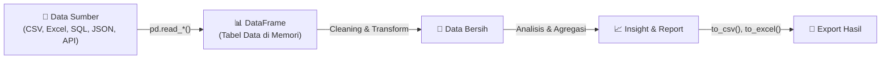

# 📘 Modul 06: Pandas — Manipulasi Data Tabular

---

## 🎯 Tujuan Pembelajaran
Setelah menyelesaikan modul ini, Anda diharapkan mampu:
1. Memahami dua struktur data utama Pandas: **Series** dan **DataFrame**.
2. Membaca data dari berbagai format (**CSV**, **Excel**, **JSON**).
3. Menguasai **seleksi data** dengan `loc`, `iloc`, dan conditional filtering.
4. Melakukan **sorting**, **ranking**, dan **handling missing values**.
5. Menambahkan kolom baru dan melakukan transformasi data dasar.

---

## 1. Mengapa Pandas?

Pandas adalah library **paling penting** untuk Data Analyst Python. Pandas menyediakan struktur data tabular (mirip spreadsheet/tabel SQL) yang sangat kuat dan fleksibel.



```python
import pandas as pd
import numpy as np

# Verifikasi
print(f"Pandas version: {pd.__version__}")
```

---

## 2. Series — Array 1D Berlabel

Series adalah array satu dimensi dengan **indeks** (label).

```python
# Membuat Series
revenue = pd.Series([45, 52, 48, 61], index=["Q1", "Q2", "Q3", "Q4"])
print(revenue)
# Q1    45
# Q2    52
# Q3    48
# Q4    61
# dtype: int64

# Akses elemen
print(revenue["Q1"])        # 45 (by label)
print(revenue[0])           # 45 (by position)
print(revenue[["Q1","Q3"]]) # Multiple access

# Operasi vektorisasi
print(revenue * 1_000_000)   # Konversi ke rupiah
print(revenue.mean())        # 51.5
print(revenue.describe())    # Ringkasan statistik
```

---

## 3. DataFrame — Tabel Data 2D

DataFrame adalah struktur tabular utama — bayangkan seperti **spreadsheet** atau **tabel SQL**.

### 3.1 Membuat DataFrame

```python
# Dari dictionary
data = {
    "nama": ["Andi", "Budi", "Citra", "Dewi", "Eka"],
    "kota": ["Jakarta", "Surabaya", "Bandung", "Jakarta", "Medan"],
    "departemen": ["Marketing", "IT", "Finance", "IT", "Marketing"],
    "gaji": [12_000_000, 15_000_000, 13_500_000, 14_000_000, 11_000_000],
    "rating": [4.2, 4.8, 3.9, 4.5, 4.1]
}

df = pd.DataFrame(data)
print(df)
```

**Output:**
```
    nama      kota departemen       gaji  rating
0   Andi   Jakarta  Marketing  12000000     4.2
1   Budi  Surabaya         IT  15000000     4.8
2  Citra   Bandung    Finance  13500000     3.9
3   Dewi   Jakarta         IT  14000000     4.5
4    Eka     Medan  Marketing  11000000     4.1
```

### 3.2 Membaca Data dari File

```python
# CSV — format paling umum
df = pd.read_csv("data_penjualan.csv")
df = pd.read_csv("data.csv", sep=";", encoding="utf-8")  # Custom separator
df = pd.read_csv("data.csv", parse_dates=["tanggal"])     # Parse kolom tanggal

# Excel
df = pd.read_excel("laporan.xlsx", sheet_name="Sheet1")
df = pd.read_excel("laporan.xlsx", sheet_name=0)  # Sheet pertama

# JSON
df = pd.read_json("data.json")

# Dari URL langsung
df = pd.read_csv("https://example.com/data.csv")

# Clipboard (copy dari Excel lalu jalankan)
df = pd.read_clipboard()
```

### 3.3 Eksplorasi Awal DataFrame ⭐

```python
# 👀 Melihat data
df.head()          # 5 baris pertama
df.head(10)        # 10 baris pertama
df.tail()          # 5 baris terakhir
df.sample(3)       # 3 baris acak

# 📋 Informasi struktur
df.shape           # (jumlah_baris, jumlah_kolom)
df.columns         # Daftar nama kolom
df.dtypes          # Tipe data per kolom
df.info()          # Ringkasan lengkap (dtype, non-null, memori)

# 📊 Statistik
df.describe()           # Statistik numerik (count, mean, std, min, max, quartiles)
df.describe(include='all')  # Termasuk kolom non-numerik
df['gaji'].value_counts()   # Frekuensi nilai unik
df['kota'].nunique()         # Jumlah nilai unik
```

---

## 4. Seleksi Data (Selection)

### 4.1 Seleksi Kolom

```python
# Satu kolom → menghasilkan Series
print(df["nama"])
print(df.nama)           # Alternatif (jika nama kolom tanpa spasi)

# Beberapa kolom → menghasilkan DataFrame
print(df[["nama", "gaji"]])
print(df[["nama", "kota", "rating"]])
```

### 4.2 `loc` — Seleksi Berdasarkan Label

```python
# loc[baris, kolom] — menggunakan label/nama
df.loc[0]                          # Baris index 0 (semua kolom)
df.loc[0, "nama"]                  # Baris 0, kolom "nama"
df.loc[0:2]                        # Baris 0-2 (inklusif!)
df.loc[0:2, "nama":"gaji"]        # Baris 0-2, kolom "nama" sampai "gaji"
df.loc[:, ["nama", "gaji"]]       # Semua baris, kolom tertentu
```

### 4.3 `iloc` — Seleksi Berdasarkan Posisi (Integer)

```python
# iloc[baris, kolom] — menggunakan posisi integer (mirip array)
df.iloc[0]                # Baris posisi 0
df.iloc[0, 1]             # Baris 0, kolom posisi 1
df.iloc[0:3]              # Baris posisi 0-2 (eksklusif, mirip Python slicing)
df.iloc[0:3, 0:2]         # 3 baris pertama, 2 kolom pertama
df.iloc[:, [0, 3]]        # Semua baris, kolom posisi 0 dan 3
df.iloc[-1]               # Baris terakhir
```

### 4.4 Perbedaan `loc` vs `iloc`

| Aspek | `loc` | `iloc` |
|---|---|---|
| **Jenis** | Label-based | Position-based (integer) |
| **Slicing** | Inklusif (start:stop) | Eksklusif (start:stop) |
| **Gunakan** | Nama kolom & index | Posisi numerik |
| **Contoh** | `df.loc[0:2, "nama"]` | `df.iloc[0:3, 0]` |

---

## 5. Filtering (Conditional Selection) ⭐

Filtering adalah salah satu operasi **paling sering** digunakan Data Analyst!

```python
# Filter sederhana
df_jakarta = df[df["kota"] == "Jakarta"]
df_gaji_tinggi = df[df["gaji"] > 13_000_000]
df_rating_baik = df[df["rating"] >= 4.5]

# Multiple conditions (gunakan & untuk AND, | untuk OR)
df_filtered = df[(df["kota"] == "Jakarta") & (df["gaji"] > 12_000_000)]
df_marketing_it = df[(df["departemen"] == "Marketing") | (df["departemen"] == "IT")]

# isin() — filter banyak nilai
kota_prioritas = ["Jakarta", "Surabaya"]
df_prioritas = df[df["kota"].isin(kota_prioritas)]

# str methods untuk filter teks
df_nama_a = df[df["nama"].str.startswith("A")]
df_contains = df[df["kota"].str.contains("a", case=False)]

# between() — filter range
df_mid_gaji = df[df["gaji"].between(12_000_000, 14_000_000)]

# query() — SQL-like filtering (alternatif)
df_query = df.query("kota == 'Jakarta' and gaji > 12_000_000")
```

---

## 6. Sorting & Ranking

```python
# Sort by values
df_sorted = df.sort_values("gaji", ascending=False)     # Gaji terbesar ke terkecil
df_sorted = df.sort_values(["kota", "gaji"], ascending=[True, False])  # Multi-sort

# Sort by index
df_sorted = df.sort_index(ascending=True)

# Ranking
df["rank_gaji"] = df["gaji"].rank(ascending=False)  # 1 = tertinggi
df["rank_gaji_dense"] = df["gaji"].rank(method="dense", ascending=False)

# nlargest / nsmallest — cara cepat untuk top-N
top3_gaji = df.nlargest(3, "gaji")
bottom2_rating = df.nsmallest(2, "rating")
```

---

## 7. Handling Missing Values (NaN)

Missing values adalah **masalah paling umum** dalam dataset nyata.

```python
# Membuat contoh data dengan missing values
df_missing = pd.DataFrame({
    "nama": ["Andi", "Budi", None, "Dewi", "Eka"],
    "gaji": [12_000_000, np.nan, 13_500_000, 14_000_000, np.nan],
    "rating": [4.2, 4.8, 3.9, np.nan, 4.1]
})

# 🔍 Deteksi missing values
print(df_missing.isnull())           # Tabel boolean (True jika NaN)
print(df_missing.isnull().sum())     # Jumlah NaN per kolom
print(df_missing.isnull().sum().sum())  # Total NaN di seluruh DataFrame
print(df_missing.notnull().sum())    # Jumlah non-NaN per kolom

# Persentase missing
persen_missing = (df_missing.isnull().sum() / len(df_missing)) * 100
print(persen_missing)

# ➖ Menghapus missing values
df_clean = df_missing.dropna()               # Hapus baris yang ada NaN
df_clean = df_missing.dropna(subset=["gaji"])  # Hapus hanya jika 'gaji' NaN
df_clean = df_missing.dropna(thresh=2)       # Minimal 2 non-NaN per baris

# ➕ Mengisi missing values
df_filled = df_missing.fillna(0)                              # Isi semua NaN dengan 0
df_filled = df_missing.fillna({"gaji": df_missing["gaji"].median(),
                                "rating": df_missing["rating"].mean()})
df_filled = df_missing.fillna(method="ffill")  # Forward fill
df_filled = df_missing.fillna(method="bfill")  # Backward fill
```

> [!WARNING]
> **Jangan sembarangan `dropna()`!** Menghapus baris bisa menghilangkan data penting. Selalu analisis pola missing data terlebih dahulu:
> - **MCAR** (Missing Completely at Random) → aman di-drop/fill
> - **MAR** (Missing at Random) → perlu strategi fill yang cermat
> - **MNAR** (Missing Not at Random) → bisa bias jika di-drop

---

## 8. Menambah & Mengubah Kolom

```python
# Menambah kolom baru
df["bonus"] = df["gaji"] * 0.1                    # 10% dari gaji
df["total_comp"] = df["gaji"] + df["bonus"]
df["gaji_juta"] = df["gaji"] / 1_000_000
df["kota_upper"] = df["kota"].str.upper()

# Kolom dengan kondisi
df["tier"] = np.where(df["gaji"] > 13_000_000, "Senior", "Junior")

# Kolom dengan multiple conditions
conditions = [
    df["rating"] >= 4.5,
    df["rating"] >= 4.0,
    df["rating"] >= 3.5,
]
choices = ["Excellent", "Good", "Average"]
df["performance"] = np.select(conditions, choices, default="Below Average")

# Mengubah tipe data
df["gaji"] = df["gaji"].astype(float)
df["nama"] = df["nama"].astype(str)

# Menghapus kolom
df = df.drop(columns=["bonus", "total_comp"])
# atau: df.drop(["bonus"], axis=1, inplace=True)

# Rename kolom
df = df.rename(columns={"gaji": "salary", "nama": "name"})
```

---

## 9. Export Data

```python
# Simpan ke CSV
df.to_csv("output.csv", index=False)
df.to_csv("output.csv", index=False, encoding="utf-8-sig")  # Untuk Excel Indonesia

# Simpan ke Excel
df.to_excel("output.xlsx", index=False, sheet_name="Data")

# Multiple sheets
with pd.ExcelWriter("laporan.xlsx") as writer:
    df_jakarta.to_excel(writer, sheet_name="Jakarta", index=False)
    df_surabaya.to_excel(writer, sheet_name="Surabaya", index=False)

# Simpan ke JSON
df.to_json("output.json", orient="records", indent=2)
```

---

## 🧪 Latihan Mandiri 06

### Tugas 1: Eksplorasi Dataset
1. Buat DataFrame dari data berikut:
```python
data_karyawan = {
    "id": ["K001", "K002", "K003", "K004", "K005", "K006", "K007", "K008"],
    "nama": ["Andi", "Budi", "Citra", "Dewi", "Eka", "Fajar", "Gita", "Hadi"],
    "departemen": ["IT", "Marketing", "IT", "Finance", "Marketing", "IT", "Finance", "Marketing"],
    "kota": ["Jakarta", "Surabaya", "Jakarta", "Bandung", "Jakarta", "Surabaya", "Bandung", "Medan"],
    "gaji": [15_000_000, 12_000_000, 14_500_000, 13_000_000, 11_500_000, 16_000_000, 13_500_000, 12_500_000],
    "rating": [4.5, 4.2, 4.8, 3.9, 4.0, 4.7, 4.3, 3.8],
    "tahun_masuk": [2019, 2020, 2018, 2021, 2022, 2017, 2020, 2021],
}
```
2. Tampilkan: shape, info, describe, dan 3 kolom yang dipilih.
3. Filter: karyawan IT di Jakarta dengan rating ≥ 4.5.
4. Tambahkan kolom `masa_kerja` (2024 - tahun_masuk) dan `tier` (Senior jika masa_kerja ≥ 5).
5. Sort berdasarkan gaji descending dan tampilkan top 3.

---

## ⏭️ Langkah Selanjutnya
Setelah menguasai dasar Pandas, saatnya pelajari operasi lanjutan:  
👉 **[Modul 07: Pandas Lanjutan — GroupBy, Merge, Pivot](07_Pandas_Lanjutan_GroupBy_Merge_Pivot.md)**
