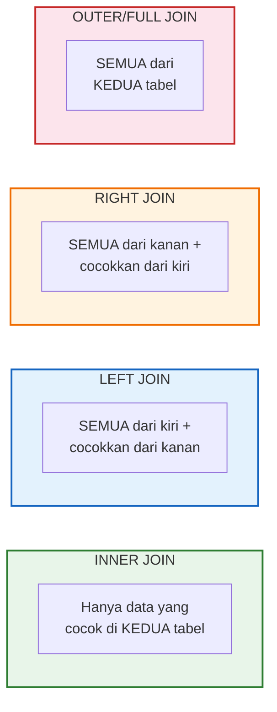

# 📘 Modul 07: Pandas Lanjutan — GroupBy, Merge & Pivot Table

---

## 🎯 Tujuan Pembelajaran
Setelah menyelesaikan modul ini, Anda diharapkan mampu:
1. Menguasai **`groupby()`** untuk agregasi data per kategori.
2. Menggabungkan tabel menggunakan **`merge()`** (SQL JOIN) dan **`concat()`** (UNION).
3. Membuat **Pivot Table** dan melakukan **`melt()`** untuk transformasi data.
4. Menggunakan **`apply()`**, **`map()`**, dan **`applymap()`** untuk transformasi kustom.
5. Menguasai teknik **string methods** dan **datetime** di Pandas.

---

## 1. GroupBy — Split-Apply-Combine ⭐

`groupby()` adalah operasi paling penting untuk agregasi data — mirip `GROUP BY` di SQL.


```python
import pandas as pd
import numpy as np

# Contoh data
df = pd.DataFrame({
    "kota": ["Jakarta", "Surabaya", "Jakarta", "Bandung", "Surabaya", 
             "Jakarta", "Bandung", "Surabaya"],
    "kategori": ["Elektronik", "Fashion", "Fashion", "Elektronik", "Elektronik",
                  "Elektronik", "Fashion", "Fashion"],
    "revenue": [15, 8, 12, 10, 14, 18, 6, 9],
    "qty": [3, 5, 8, 4, 6, 2, 10, 7],
})

# GroupBy sederhana
print(df.groupby("kota")["revenue"].sum())
# kota
# Bandung     16
# Jakarta     45
# Surabaya    31

print(df.groupby("kota")["revenue"].mean())
print(df.groupby("kota")["revenue"].count())
```

### 1.1 Multiple Aggregations dengan `agg()` ⭐

```python
# Agregasi tunggal
df.groupby("kota")["revenue"].agg("sum")

# Agregasi ganda pada satu kolom
df.groupby("kota")["revenue"].agg(["sum", "mean", "min", "max", "count"])

# Agregasi berbeda per kolom
result = df.groupby("kota").agg(
    total_revenue=("revenue", "sum"),
    avg_revenue=("revenue", "mean"),
    total_qty=("qty", "sum"),
    jumlah_transaksi=("revenue", "count"),
).reset_index()

print(result)
```

### 1.2 GroupBy Multi-Level

```python
# Group by 2 kolom
multi_group = df.groupby(["kota", "kategori"]).agg(
    total_revenue=("revenue", "sum"),
    avg_qty=("qty", "mean"),
).reset_index()

print(multi_group)
# Output:
#        kota    kategori  total_revenue  avg_qty
# 0   Bandung  Elektronik             10      4.0
# 1   Bandung     Fashion              6     10.0
# 2   Jakarta  Elektronik             33      2.5
# 3   Jakarta     Fashion             12      8.0
# 4  Surabaya  Elektronik             14      6.0
# 5  Surabaya     Fashion             17      6.0
```

### 1.3 Transform vs Agg

```python
# agg() — mengurangi data (banyak baris → sedikit baris)
# transform() — mengembalikan data dengan ukuran sama (untuk menambah kolom)

# Menambahkan kolom rata-rata per grup (tanpa mengubah jumlah baris)
df["avg_revenue_kota"] = df.groupby("kota")["revenue"].transform("mean")
df["pct_of_kota_total"] = df["revenue"] / df.groupby("kota")["revenue"].transform("sum") * 100

print(df[["kota", "revenue", "avg_revenue_kota", "pct_of_kota_total"]])
```

---

## 2. Merge — Menggabungkan Tabel (SQL JOIN)

`merge()` menggabungkan dua tabel berdasarkan kolom kunci — persis seperti **JOIN** di SQL.

```python
# Tabel Orders (Fact)
orders = pd.DataFrame({
    "order_id": [1, 2, 3, 4, 5],
    "customer_id": ["C01", "C02", "C01", "C03", "C04"],
    "product_id": ["P01", "P02", "P03", "P01", "P02"],
    "qty": [2, 1, 3, 1, 5],
})

# Tabel Customers (Dimension)
customers = pd.DataFrame({
    "customer_id": ["C01", "C02", "C03", "C05"],
    "nama": ["Andi", "Budi", "Citra", "Eka"],
    "kota": ["Jakarta", "Surabaya", "Bandung", "Medan"],
})

# Tabel Products (Dimension)
products = pd.DataFrame({
    "product_id": ["P01", "P02", "P03"],
    "nama_produk": ["Laptop", "Mouse", "Keyboard"],
    "harga": [15_000_000, 150_000, 350_000],
})
```

### 2.1 Jenis-Jenis JOIN

```python
# INNER JOIN (default) — hanya yang cocok di KEDUA tabel
inner = pd.merge(orders, customers, on="customer_id", how="inner")
# C04 hilang (tidak ada di customers), C05 hilang (tidak ada di orders)

# LEFT JOIN — semua dari tabel kiri, cocokkan kanan
left = pd.merge(orders, customers, on="customer_id", how="left")
# C04 tetap ada, tapi nama & kota = NaN

# RIGHT JOIN — semua dari tabel kanan, cocokkan kiri
right = pd.merge(orders, customers, on="customer_id", how="right")
# C05 tetap ada, tapi order data = NaN

# OUTER JOIN — semua dari KEDUA tabel
outer = pd.merge(orders, customers, on="customer_id", how="outer")
# C04 dan C05 tetap ada, dengan NaN di kolom yang tidak cocok
```



### 2.2 Merge Bertingkat (Multi-table JOIN)

```python
# Gabungkan orders + customers + products
df_full = (orders
    .merge(customers, on="customer_id", how="left")
    .merge(products, on="product_id", how="left")
)

# Hitung total per order
df_full["total"] = df_full["qty"] * df_full["harga"]
print(df_full[["order_id", "nama", "nama_produk", "qty", "harga", "total"]])
```

---

## 3. Concat — Menggabungkan Data Secara Vertikal/Horizontal

```python
# Vertikal (UNION) — menumpuk baris
df_jan = pd.DataFrame({"bulan": "Jan", "revenue": [10, 12, 8]})
df_feb = pd.DataFrame({"bulan": "Feb", "revenue": [15, 11, 13]})
df_mar = pd.DataFrame({"bulan": "Mar", "revenue": [14, 16, 12]})

df_q1 = pd.concat([df_jan, df_feb, df_mar], ignore_index=True)
print(df_q1)

# Horizontal — menggabungkan kolom
info = pd.DataFrame({"nama": ["A", "B", "C"]})
scores = pd.DataFrame({"skor": [85, 92, 78]})
gabung = pd.concat([info, scores], axis=1)
print(gabung)
```

---

## 4. Pivot Table — Tabel Ringkasan Multi-Dimensi ⭐

Pivot table mengubah data long-format menjadi tabel ringkasan — mirip Pivot Table di Excel!

```python
# Data penjualan
df_sales = pd.DataFrame({
    "tanggal": pd.date_range("2024-01-01", periods=12, freq="M"),
    "kota": ["Jakarta", "Surabaya"] * 6,
    "kategori": ["Elektronik", "Fashion", "Elektronik", "Fashion"] * 3,
    "revenue": [45, 32, 38, 28, 52, 35, 41, 30, 55, 38, 48, 33],
})

# Pivot table
pivot = pd.pivot_table(
    df_sales,
    values="revenue",
    index="kota",
    columns="kategori",
    aggfunc="sum",
    margins=True,          # Menambahkan total
    margins_name="Total"
)
print(pivot)
# kategori    Elektronik  Fashion  Total
# kota
# Jakarta            145       93    238
# Surabaya           107      128    235
# Total              252      221    473
```

### Melt — Kebalikan Pivot (Wide → Long)

```python
# Data wide-format
df_wide = pd.DataFrame({
    "kota": ["Jakarta", "Surabaya", "Bandung"],
    "Q1": [45, 38, 30],
    "Q2": [52, 41, 35],
    "Q3": [48, 44, 32],
    "Q4": [61, 50, 40],
})

# Melt → Long format
df_long = pd.melt(
    df_wide,
    id_vars=["kota"],
    value_vars=["Q1", "Q2", "Q3", "Q4"],
    var_name="kuartal",
    value_name="revenue"
)
print(df_long)
#         kota kuartal  revenue
# 0   Jakarta      Q1       45
# 1  Surabaya      Q1       38
# 2   Bandung      Q1       30
# 3   Jakarta      Q2       52
# ...
```

---

## 5. Apply, Map & Applymap

### 5.1 `apply()` — Terapkan Fungsi ke Kolom/Baris

```python
# apply() pada Series (kolom)
df["gaji_juta"] = df["gaji"].apply(lambda x: f"Rp {x/1_000_000:.1f} Juta")

# apply() dengan fungsi kustom
def kategorisasi_revenue(rev):
    if rev >= 50:
        return "High"
    elif rev >= 30:
        return "Medium"
    else:
        return "Low"

df["revenue_category"] = df["revenue"].apply(kategorisasi_revenue)

# apply() pada baris (axis=1)
def hitung_kpi(row):
    return row["revenue"] * row["qty"] * 0.1

df["kpi_score"] = df.apply(hitung_kpi, axis=1)
```

### 5.2 `map()` — Mapping Nilai

```python
# map() dengan dictionary
kota_mapping = {
    "Jakarta": "DKI Jakarta",
    "Surabaya": "Jawa Timur",
    "Bandung": "Jawa Barat",
}
df["provinsi"] = df["kota"].map(kota_mapping)

# map() dengan fungsi
df["nama_upper"] = df["nama"].map(str.upper)
```

---

## 6. String Methods (`.str`)

```python
df_text = pd.DataFrame({
    "nama": ["  andi santoso  ", "BUDI PRASETYO", "citra dewi", "Dewi Sri"],
    "email": ["andi@gmail.com", "budi@yahoo.com", "citra@company.co.id", None],
    "kode_pos": ["12345", "60123", "40123", "20117"],
})

# String cleaning
df_text["nama_clean"] = df_text["nama"].str.strip().str.title()
df_text["nama_lower"] = df_text["nama"].str.lower().str.strip()

# String filtering
df_gmail = df_text[df_text["email"].str.contains("gmail", na=False)]
df_starts_a = df_text[df_text["nama_clean"].str.startswith("A")]

# String extraction
df_text["domain"] = df_text["email"].str.split("@").str[-1]
df_text["nama_depan"] = df_text["nama_clean"].str.split().str[0]

# String length
df_text["panjang_nama"] = df_text["nama_clean"].str.len()

# Replace
df_text["email_masked"] = df_text["email"].str.replace(r"@.*", "@***", regex=True)
```

---

## 7. DateTime Operations

```python
# Membuat datetime
df_time = pd.DataFrame({
    "tanggal": pd.date_range("2024-01-01", periods=365, freq="D"),
    "revenue": np.random.randint(10, 100, size=365)
})

# Ekstrak komponen tanggal
df_time["tahun"] = df_time["tanggal"].dt.year
df_time["bulan"] = df_time["tanggal"].dt.month
df_time["nama_bulan"] = df_time["tanggal"].dt.month_name()
df_time["hari"] = df_time["tanggal"].dt.day
df_time["nama_hari"] = df_time["tanggal"].dt.day_name()
df_time["kuartal"] = df_time["tanggal"].dt.quarter
df_time["minggu_ke"] = df_time["tanggal"].dt.isocalendar().week

# Resample — agregasi berdasarkan waktu
monthly = df_time.resample("M", on="tanggal")["revenue"].sum()
weekly = df_time.resample("W", on="tanggal")["revenue"].mean()
quarterly = df_time.resample("Q", on="tanggal")["revenue"].agg(["sum", "mean"])

# Filtering berdasarkan tanggal
df_q1 = df_time[(df_time["tanggal"] >= "2024-01-01") & (df_time["tanggal"] < "2024-04-01")]

# Rolling window (Moving Average)
df_time["ma_7d"] = df_time["revenue"].rolling(window=7).mean()
df_time["ma_30d"] = df_time["revenue"].rolling(window=30).mean()
```

---

## 🧪 Latihan Mandiri 07

### Tugas 1: GroupBy Analysis
Dari data penjualan berikut:
```python
sales = pd.DataFrame({
    "tanggal": pd.date_range("2024-01-01", periods=100, freq="D"),
    "kota": np.random.choice(["Jakarta", "Surabaya", "Bandung", "Medan"], 100),
    "kategori": np.random.choice(["Elektronik", "Fashion", "F&B", "Kesehatan"], 100),
    "revenue": np.random.randint(5_000_000, 50_000_000, 100),
    "qty": np.random.randint(1, 50, 100),
})
```
Analisis: total revenue per kota, rata-rata revenue per kategori per kota, persentase kontribusi setiap kota terhadap total.

### Tugas 2: Multi-table Merge
Buat 3 tabel (orders, customers, products) dan gabungkan. Hitung: total pembelian per pelanggan, produk terlaris, dan kota dengan revenue tertinggi.

### Tugas 3: Pivot & Time Series
Dari data yang sama, buat pivot table (kota vs bulan) dan hitung moving average 7 hari.

---

## ⏭️ Langkah Selanjutnya
Setelah menguasai operasi lanjutan Pandas, pelajari cara membersihkan data:  
👉 **[Modul 08: Data Cleaning & Preprocessing](08_Data_Cleaning_dan_Preprocessing.md)**
