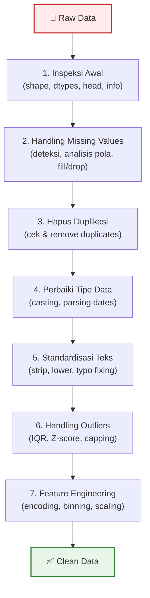

# 📘 Modul 08: Data Cleaning & Preprocessing

---

## 🎯 Tujuan Pembelajaran
Setelah menyelesaikan modul ini, Anda diharapkan mampu:
1. Menerapkan **proses data cleaning** yang sistematis dan terstruktur.
2. Menangani **missing values** dengan strategi yang tepat.
3. Mendeteksi dan menangani **duplikasi** dan **outlier**.
4. Melakukan **encoding** data kategorikal dan **normalisasi/standardisasi** data numerik.
5. Menggunakan **Regular Expressions (regex)** untuk membersihkan data teks.

---

## 1. Alur Data Cleaning Sistematis



> [!IMPORTANT]
> **80% waktu Data Analyst** dihabiskan untuk data cleaning dan preprocessing. Menguasai tahap ini adalah kunci menjadi analis yang efektif dan terpercaya.

---

## 2. Inspeksi Awal Data

```python
import pandas as pd
import numpy as np

# Simulasi data kotor
df = pd.DataFrame({
    "nama": ["  Andi ", "BUDI", "citra", "Andi ", "dewi", None, "Eka", "budi"],
    "email": ["andi@gmail.com", "budi@yahoo.com", "invalid-email", 
              "andi@gmail.com", "dewi@mail.com", "eka@mail.com", "eka@mail.com", "budi@yahoo.com"],
    "kota": ["Jakarta", "surabaya", "BANDUNG", "Jakarta", "jakarta", "Medan", "Bandung", "Surabaya"],
    "gaji": [12000000, 15000000, -5000000, 12000000, 8000000, None, 95000000, 14000000],
    "tanggal_lahir": ["1990-05-15", "1988/03/22", "15-08-1992", "1990-05-15",
                       "1995-12-01", "01/01/1985", "2000-06-30", "1988-03-22"],
    "rating": ["4.5", "4.2", "N/A", "4.5", "3.8", "-", "4.9", "4.2"],
})

# 🔍 Inspeksi
print(f"Shape: {df.shape}")
print(f"\n{df.info()}")
print(f"\n{df.head()}")
print(f"\nMissing values:\n{df.isnull().sum()}")
print(f"\nDuplikasi: {df.duplicated().sum()} baris")
print(f"\nNilai unik 'kota': {df['kota'].unique()}")
```

---

## 3. Handling Missing Values (Lanjutan)

### 3.1 Analisis Pola Missing

```python
# Persentase missing per kolom
missing_report = pd.DataFrame({
    "kolom": df.columns,
    "missing_count": df.isnull().sum().values,
    "missing_pct": (df.isnull().sum() / len(df) * 100).values,
    "dtype": df.dtypes.values
})
missing_report = missing_report.sort_values("missing_pct", ascending=False)
print(missing_report)

# Visualisasi pola missing (konsep)
# import missingno as msno
# msno.matrix(df)
```

### 3.2 Strategi Penanganan

```python
# Strategi 1: Drop — jika jumlah missing sangat sedikit (< 5%)
df_clean = df.dropna(subset=["nama"])  # Hapus baris jika nama kosong

# Strategi 2: Fill dengan statistik
df["gaji"] = df["gaji"].fillna(df["gaji"].median())

# Strategi 3: Fill berdasarkan grup
df["gaji"] = df.groupby("kota")["gaji"].transform(
    lambda x: x.fillna(x.median())
)

# Strategi 4: Fill dengan forward/backward
df["rating_filled"] = df["rating"].fillna(method="ffill")

# Strategi 5: Interpolasi (untuk time series)
df["gaji_interpolated"] = df["gaji"].interpolate(method="linear")
```

---

## 4. Handling Duplikasi

```python
# 4.1 Deteksi duplikasi
print(f"Jumlah baris duplikat penuh: {df.duplicated().sum()}")
print(f"Duplikat pada kolom 'nama': {df.duplicated(subset=['nama']).sum()}")
print(f"Duplikat pada kolom ['nama', 'email']: {df.duplicated(subset=['nama', 'email']).sum()}")

# Lihat baris duplikat
duplikat = df[df.duplicated(keep=False)]  # keep=False → tampilkan semua duplikat
print(duplikat)

# 4.2 Hapus duplikasi
df_no_dup = df.drop_duplicates()                          # Hapus baris duplikat penuh
df_no_dup = df.drop_duplicates(subset=["nama", "email"])  # Berdasarkan kolom tertentu
df_no_dup = df.drop_duplicates(subset=["email"], keep="last")  # Simpan kemunculan terakhir
```

---

## 5. Perbaiki Tipe Data & Standardisasi

### 5.1 Standardisasi Teks

```python
# Membersihkan dan menyeragamkan teks
df["nama"] = (df["nama"]
    .str.strip()           # Hapus spasi di ujung
    .str.title()           # Title Case
)

df["kota"] = (df["kota"]
    .str.strip()
    .str.title()
)

# Memperbaiki variasi penulisan (typo mapping)
kota_mapping = {
    "Jkt": "Jakarta",
    "Sby": "Surabaya",
    "Bdg": "Bandung",
    "Jkrt": "Jakarta",
}
df["kota"] = df["kota"].replace(kota_mapping)

print(df["kota"].value_counts())  # Verifikasi
```

### 5.2 Konversi Tipe Data

```python
# String numerik ke numeric
df["rating_clean"] = pd.to_numeric(df["rating"], errors="coerce")  
# "N/A", "-" → NaN otomatis!

# String tanggal ke datetime
df["tanggal_lahir_clean"] = pd.to_datetime(df["tanggal_lahir"], 
                                             format="mixed",   # Auto-detect format
                                             dayfirst=False,
                                             errors="coerce")  # Invalid → NaT

# Konversi manual
df["gaji"] = df["gaji"].astype(float)
```

---

## 6. Handling Outliers ⭐

Outlier adalah nilai yang **sangat jauh** dari distribusi normal data. Bisa berupa kesalahan input atau nilai valid yang ekstrem.

### 6.1 Metode IQR (Interquartile Range)

```python
def detect_outliers_iqr(df, column):
    """Deteksi outlier menggunakan metode IQR."""
    Q1 = df[column].quantile(0.25)
    Q3 = df[column].quantile(0.75)
    IQR = Q3 - Q1
    lower_bound = Q1 - 1.5 * IQR
    upper_bound = Q3 + 1.5 * IQR
    
    outliers = df[(df[column] < lower_bound) | (df[column] > upper_bound)]
    
    print(f"📊 Outlier Analysis: {column}")
    print(f"   Q1: {Q1:,.0f} | Q3: {Q3:,.0f} | IQR: {IQR:,.0f}")
    print(f"   Lower Bound: {lower_bound:,.0f}")
    print(f"   Upper Bound: {upper_bound:,.0f}")
    print(f"   Outliers found: {len(outliers)}")
    
    return outliers, lower_bound, upper_bound

outliers, lb, ub = detect_outliers_iqr(df, "gaji")
```

### 6.2 Metode Z-Score

```python
from scipy import stats

def detect_outliers_zscore(df, column, threshold=3):
    """Deteksi outlier menggunakan Z-score."""
    z_scores = np.abs(stats.zscore(df[column].dropna()))
    outlier_mask = z_scores > threshold
    return df[column].dropna()[outlier_mask]

# Z-score > 3 dianggap outlier
outliers_z = detect_outliers_zscore(df, "gaji")
```

### 6.3 Strategi Penanganan Outlier

```python
# Strategi 1: Capping (Winsorization) — batasi ke batas IQR
df["gaji_capped"] = df["gaji"].clip(lower=lb, upper=ub)

# Strategi 2: Hapus outlier
df_no_outlier = df[(df["gaji"] >= lb) & (df["gaji"] <= ub)]

# Strategi 3: Transformasi log (untuk distribusi skewed)
df["gaji_log"] = np.log1p(df["gaji"])  # log(1 + x) aman untuk 0

# Strategi 4: Ganti dengan median
median_gaji = df["gaji"].median()
df["gaji_fixed"] = np.where(
    (df["gaji"] < lb) | (df["gaji"] > ub),
    median_gaji,
    df["gaji"]
)
```

> [!WARNING]
> **Jangan otomatis menghapus outlier!** Selalu investigasi terlebih dahulu:
> - Apakah outlier karena **kesalahan input** (typo, unit salah)?
> - Apakah outlier merupakan **data valid** yang memang ekstrem (CEO salary, Black Friday sales)?
> - Bagaimana **dampaknya** terhadap analisis jika di-drop vs di-cap?

---

## 7. Regular Expressions (Regex)

```python
import re

# Contoh data kotor
data_harga = pd.Series([
    "Rp 15.000.000", 
    "Rp. 8,500,000", 
    "25000000",
    "IDR 12.000.000",
    "Rp15000000",
    "FREE",
    "Rp 0",
])

# Ekstrak angka saja
angka_bersih = data_harga.str.replace(r"[^\d]", "", regex=True)
angka_numerik = pd.to_numeric(angka_bersih, errors="coerce")
print(angka_numerik)

# Validasi email
emails = pd.Series(["andi@gmail.com", "invalid-email", "budi@yahoo.com", "no_at_sign"])
email_valid = emails.str.match(r"^[\w.-]+@[\w.-]+\.\w+$")
print(emails[email_valid])

# Ekstrak domain dari email
domain = emails.str.extract(r"@([\w.-]+)")
print(domain)

# Pola regex yang sering digunakan
pola_umum = {
    "Hanya angka": r"^\d+$",
    "Email": r"^[\w.-]+@[\w.-]+\.\w+$",
    "No HP Indonesia": r"^(\+62|62|0)8\d{8,11}$",
    "Kode Pos": r"^\d{5}$",
    "Tanggal YYYY-MM-DD": r"^\d{4}-\d{2}-\d{2}$",
}
```

---

## 8. Encoding Data Kategorikal

```python
# 8.1 Label Encoding — kategori ordinal (ada urutan)
size_map = {"S": 1, "M": 2, "L": 3, "XL": 4}
df["size_encoded"] = df["size"].map(size_map)

# Atau menggunakan pandas
df["kota_code"] = df["kota"].astype("category").cat.codes

# 8.2 One-Hot Encoding — kategori nominal (tidak ada urutan)
df_encoded = pd.get_dummies(df, columns=["kota", "kategori"], prefix=["kota", "kat"])
print(df_encoded.columns)
# ['kota_Bandung', 'kota_Jakarta', 'kota_Surabaya', 'kat_Elektronik', 'kat_Fashion']

# 8.3 Binning — mengubah numerik menjadi kategori
df["gaji_bin"] = pd.cut(df["gaji"], bins=[0, 10e6, 15e6, 20e6, np.inf],
                         labels=["Low", "Medium", "High", "Very High"])

df["umur_bin"] = pd.qcut(df["umur"], q=4, labels=["Q1", "Q2", "Q3", "Q4"])  # Equal-frequency
```

---

## 9. Normalisasi & Standardisasi

```python
# 9.1 Min-Max Normalization (skala 0-1)
def min_max_normalize(series):
    return (series - series.min()) / (series.max() - series.min())

df["gaji_normalized"] = min_max_normalize(df["gaji"])

# 9.2 Z-Score Standardization (mean=0, std=1)
def z_score_standardize(series):
    return (series - series.mean()) / series.std()

df["gaji_standardized"] = z_score_standardize(df["gaji"])

# 9.3 Menggunakan sklearn (lebih robust)
from sklearn.preprocessing import MinMaxScaler, StandardScaler

scaler_mm = MinMaxScaler()
df[["gaji_mm"]] = scaler_mm.fit_transform(df[["gaji"]])

scaler_ss = StandardScaler()
df[["gaji_ss"]] = scaler_ss.fit_transform(df[["gaji"]])
```

---

## 10. Data Cleaning Pipeline (Best Practice)

```python
def clean_sales_data(filepath):
    """Pipeline data cleaning end-to-end."""
    
    # 1. Load data
    print("📥 Loading data...")
    df = pd.read_csv(filepath)
    print(f"   Shape awal: {df.shape}")
    
    # 2. Hapus duplikasi
    print("🔄 Menghapus duplikasi...")
    before = len(df)
    df = df.drop_duplicates()
    print(f"   Dihapus: {before - len(df)} baris duplikat")
    
    # 3. Standardisasi teks
    print("📝 Standardisasi teks...")
    text_cols = df.select_dtypes(include="object").columns
    for col in text_cols:
        df[col] = df[col].str.strip().str.title()
    
    # 4. Perbaiki tipe data
    print("🔧 Perbaiki tipe data...")
    if "tanggal" in df.columns:
        df["tanggal"] = pd.to_datetime(df["tanggal"], errors="coerce")
    
    numeric_cols = ["revenue", "qty", "harga"]
    for col in numeric_cols:
        if col in df.columns:
            df[col] = pd.to_numeric(df[col], errors="coerce")
    
    # 5. Handle missing values
    print("🩹 Handling missing values...")
    missing_pct = df.isnull().sum() / len(df) * 100
    print(f"   Missing:\n{missing_pct[missing_pct > 0]}")
    
    for col in df.select_dtypes(include=np.number).columns:
        df[col] = df[col].fillna(df[col].median())
    
    for col in df.select_dtypes(include="object").columns:
        df[col] = df[col].fillna("Unknown")
    
    # 6. Handle outliers (capping)
    print("📊 Handling outliers...")
    for col in df.select_dtypes(include=np.number).columns:
        Q1, Q3 = df[col].quantile(0.25), df[col].quantile(0.75)
        IQR = Q3 - Q1
        df[col] = df[col].clip(lower=Q1 - 1.5*IQR, upper=Q3 + 1.5*IQR)
    
    print(f"✅ Cleaning selesai! Shape akhir: {df.shape}")
    return df

# Gunakan pipeline
# df_clean = clean_sales_data("data_penjualan.csv")
```

---

## 🧪 Latihan Mandiri 08

### Tugas: Data Cleaning End-to-End
Bersihkan dataset berikut dengan menerapkan semua teknik yang telah dipelajari:
```python
dirty_data = pd.DataFrame({
    "Nama Pelanggan": ["  andi  ", "BUDI", "citra", "  andi  ", None, "EKA", "dewi", "budi"],
    "Email": ["andi@gmail.com", "budi@mail", "citra@yahoo.com", "andi@gmail.com", 
              "eka@mail.com", "eka@mail.com", "invalid", "budi@gmail.com"],
    "Kota": ["Jakarta", "surabaya", "BANDUNG", "jakarta", "Medan", "bandung", "Jkt", "Sby"],
    "Total Belanja": ["Rp 15.000.000", "25000000", "Rp. 8,500,000", "Rp 15.000.000",
                       "-", "Rp 950.000.000", "Rp 3.000.000", "Rp 25.000.000"],
    "Rating": [4.5, 3.8, 4.2, 4.5, None, 4.9, -1, 3.8],
    "Tanggal Registrasi": ["2023-01-15", "15/03/2023", "2023-06-01", "2023-01-15",
                            "2022-12-31", "2024-01-20", "invalid", "2023-03-15"],
})
```
Langkah: inspeksi → clean teks → fix tipe data → hapus duplikat → handle missing → handle outlier → validasi email → export ke CSV.

---

## ⏭️ Langkah Selanjutnya
Setelah menguasai data cleaning, saatnya memvisualisasikan data:  
👉 **[Modul 09: Visualisasi Data — Matplotlib & Seaborn](09_Visualisasi_Data_Matplotlib_Seaborn.md)**
