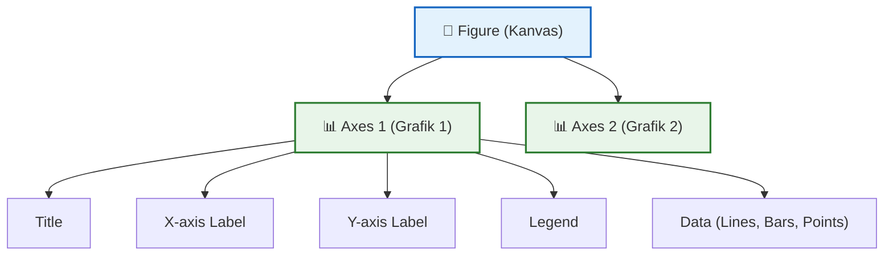

# 📘 Modul 09: Visualisasi Data — Matplotlib & Seaborn

---

## 🎯 Tujuan Pembelajaran
Setelah menyelesaikan modul ini, Anda diharapkan mampu:
1. Memahami **anatomi grafik** Matplotlib (`Figure`, `Axes`, `Artist`).
2. Membuat berbagai jenis **grafik dasar** (line, bar, scatter, pie, histogram).
3. **Mengkustomisasi** grafik secara profesional (warna, label, legend, annotation).
4. Menggunakan **Seaborn** untuk visualisasi statistik yang indah.
5. Membuat **dashboard mini** dengan `subplot` dan layout multi-panel.

---

## 1. Matplotlib — Library Visualisasi Dasar

### 1.1 Konsep Dasar: Figure & Axes

```python
import matplotlib.pyplot as plt
import numpy as np
import pandas as pd

# Anatomi grafik Matplotlib
# Figure  → Kanvas keseluruhan (bisa berisi banyak grafik)
# Axes    → Area grafik individual (1 grafik)
# Artist  → Elemen visual (garis, teks, titik, dll)
```



### 1.2 Grafik Pertama

```python
# Cara 1: plt interface (cepat, sederhana)
bulan = ["Jan", "Feb", "Mar", "Apr", "Mei", "Jun"]
revenue = [45, 52, 48, 61, 55, 67]

plt.figure(figsize=(10, 6))
plt.plot(bulan, revenue, marker="o", color="#2196F3", linewidth=2, markersize=8)
plt.title("Revenue Bulanan 2024", fontsize=16, fontweight="bold")
plt.xlabel("Bulan", fontsize=12)
plt.ylabel("Revenue (Juta Rp)", fontsize=12)
plt.grid(True, alpha=0.3)
plt.tight_layout()
plt.savefig("revenue_chart.png", dpi=150, bbox_inches="tight")
plt.show()

# Cara 2: Object-oriented (lebih fleksibel & profesional) ⭐
fig, ax = plt.subplots(figsize=(10, 6))
ax.plot(bulan, revenue, marker="o", color="#2196F3", linewidth=2, markersize=8)
ax.set_title("Revenue Bulanan 2024", fontsize=16, fontweight="bold")
ax.set_xlabel("Bulan", fontsize=12)
ax.set_ylabel("Revenue (Juta Rp)", fontsize=12)
ax.grid(True, alpha=0.3)
fig.tight_layout()
plt.show()
```

---

## 2. Jenis-Jenis Grafik

### 2.1 Line Chart (Grafik Garis) — Tren Waktu

```python
bulan = np.arange(1, 13)
revenue_2023 = [38, 42, 45, 41, 48, 52, 49, 55, 58, 54, 62, 68]
revenue_2024 = [45, 52, 48, 61, 55, 67, 63, 72, 69, 75, 80, 85]

fig, ax = plt.subplots(figsize=(12, 6))

ax.plot(bulan, revenue_2023, marker="o", label="2023", color="#FF7043", linewidth=2)
ax.plot(bulan, revenue_2024, marker="s", label="2024", color="#42A5F5", linewidth=2)

ax.fill_between(bulan, revenue_2023, revenue_2024, alpha=0.1, color="#42A5F5")

ax.set_title("Perbandingan Revenue 2023 vs 2024", fontsize=16, fontweight="bold")
ax.set_xlabel("Bulan", fontsize=12)
ax.set_ylabel("Revenue (Juta Rp)", fontsize=12)
ax.set_xticks(bulan)
ax.set_xticklabels(["Jan","Feb","Mar","Apr","Mei","Jun","Jul","Agu","Sep","Okt","Nov","Des"])
ax.legend(fontsize=11, loc="upper left")
ax.grid(True, alpha=0.3, linestyle="--")
fig.tight_layout()
plt.show()
```

### 2.2 Bar Chart (Grafik Batang) — Perbandingan Kategori

```python
kota = ["Jakarta", "Surabaya", "Bandung", "Medan", "Semarang"]
revenue = [85, 62, 48, 35, 28]
colors = ["#1976D2", "#388E3C", "#F57C00", "#D32F2F", "#7B1FA2"]

fig, ax = plt.subplots(figsize=(10, 6))
bars = ax.bar(kota, revenue, color=colors, edgecolor="white", linewidth=1.5)

# Tambahkan label nilai di atas bar
for bar, val in zip(bars, revenue):
    ax.text(bar.get_x() + bar.get_width()/2, bar.get_height() + 1,
            f"Rp {val}M", ha="center", va="bottom", fontsize=11, fontweight="bold")

ax.set_title("Revenue per Kota (Miliar Rp)", fontsize=16, fontweight="bold")
ax.set_ylabel("Revenue (Miliar Rp)", fontsize=12)
ax.spines["top"].set_visible(False)
ax.spines["right"].set_visible(False)
fig.tight_layout()
plt.show()
```

### 2.3 Horizontal Bar Chart

```python
# Cocok untuk banyak kategori atau label panjang
fig, ax = plt.subplots(figsize=(10, 6))
bars = ax.barh(kota, revenue, color=colors, edgecolor="white")
ax.invert_yaxis()  # Terbesar di atas
ax.set_xlabel("Revenue (Miliar Rp)")
ax.set_title("Revenue per Kota")
fig.tight_layout()
plt.show()
```

### 2.4 Grouped & Stacked Bar Chart

```python
# Grouped bar
x = np.arange(len(kota))
width = 0.35
revenue_online = [35, 25, 20, 15, 12]
revenue_offline = [50, 37, 28, 20, 16]

fig, ax = plt.subplots(figsize=(12, 6))
ax.bar(x - width/2, revenue_online, width, label="Online", color="#42A5F5")
ax.bar(x + width/2, revenue_offline, width, label="Offline", color="#66BB6A")
ax.set_xticks(x)
ax.set_xticklabels(kota)
ax.legend()
ax.set_title("Revenue Online vs Offline per Kota")
fig.tight_layout()
plt.show()

# Stacked bar
fig, ax = plt.subplots(figsize=(12, 6))
ax.bar(kota, revenue_online, label="Online", color="#42A5F5")
ax.bar(kota, revenue_offline, bottom=revenue_online, label="Offline", color="#66BB6A")
ax.legend()
ax.set_title("Revenue Online + Offline (Stacked)")
fig.tight_layout()
plt.show()
```

### 2.5 Scatter Plot — Korelasi Dua Variabel

```python
np.random.seed(42)
ad_spend = np.random.uniform(5, 50, 50)
revenue = ad_spend * 2.5 + np.random.normal(0, 10, 50)

fig, ax = plt.subplots(figsize=(10, 6))
scatter = ax.scatter(ad_spend, revenue, c=revenue, cmap="viridis", 
                      s=80, alpha=0.7, edgecolors="white")
plt.colorbar(scatter, label="Revenue")

# Trend line
z = np.polyfit(ad_spend, revenue, 1)
p = np.poly1d(z)
ax.plot(sorted(ad_spend), p(sorted(ad_spend)), "--", color="red", alpha=0.8, label="Trend")

ax.set_title("Korelasi Ad Spend vs Revenue", fontsize=16, fontweight="bold")
ax.set_xlabel("Ad Spend (Juta Rp)", fontsize=12)
ax.set_ylabel("Revenue (Juta Rp)", fontsize=12)
ax.legend()
fig.tight_layout()
plt.show()
```

### 2.6 Histogram — Distribusi Data

```python
np.random.seed(42)
gaji = np.random.normal(loc=15_000_000, scale=3_000_000, size=500)

fig, ax = plt.subplots(figsize=(10, 6))
n, bins, patches = ax.hist(gaji, bins=25, color="#42A5F5", edgecolor="white", alpha=0.8)

# Garis mean & median
ax.axvline(np.mean(gaji), color="red", linestyle="--", linewidth=2, label=f"Mean: Rp {np.mean(gaji):,.0f}")
ax.axvline(np.median(gaji), color="green", linestyle="--", linewidth=2, label=f"Median: Rp {np.median(gaji):,.0f}")

ax.set_title("Distribusi Gaji Karyawan", fontsize=16, fontweight="bold")
ax.set_xlabel("Gaji (Rp)", fontsize=12)
ax.set_ylabel("Frekuensi", fontsize=12)
ax.legend(fontsize=11)
fig.tight_layout()
plt.show()
```

### 2.7 Pie / Donut Chart — Proporsi

```python
kategori = ["Elektronik", "Fashion", "F&B", "Kesehatan", "Lainnya"]
proporsi = [35, 25, 20, 12, 8]
colors = ["#1976D2", "#F57C00", "#388E3C", "#D32F2F", "#7B1FA2"]
explode = (0.05, 0, 0, 0, 0)

fig, (ax1, ax2) = plt.subplots(1, 2, figsize=(14, 6))

# Pie chart
ax1.pie(proporsi, labels=kategori, autopct="%1.1f%%", colors=colors,
        explode=explode, shadow=True, startangle=90)
ax1.set_title("Proporsi Revenue per Kategori (Pie)", fontsize=14, fontweight="bold")

# Donut chart
wedges, texts, autotexts = ax2.pie(proporsi, labels=kategori, autopct="%1.1f%%",
                                     colors=colors, pctdistance=0.75, startangle=90)
center_circle = plt.Circle((0, 0), 0.5, fc="white")
ax2.add_artist(center_circle)
ax2.set_title("Proporsi Revenue per Kategori (Donut)", fontsize=14, fontweight="bold")

fig.tight_layout()
plt.show()
```

---

## 3. Subplot — Multi-Panel Dashboard

```python
fig, axes = plt.subplots(2, 2, figsize=(16, 12))

# Panel 1: Line chart
axes[0, 0].plot(bulan, revenue_2024[:6], marker="o", color="#1976D2")
axes[0, 0].set_title("Tren Revenue H1-2024")
axes[0, 0].set_ylabel("Revenue (Juta)")

# Panel 2: Bar chart
axes[0, 1].bar(kota[:4], revenue[:4], color=colors[:4])
axes[0, 1].set_title("Revenue per Kota")

# Panel 3: Scatter
axes[1, 0].scatter(ad_spend[:20], revenue[:20], color="#F57C00", alpha=0.7)
axes[1, 0].set_title("Ad Spend vs Revenue")
axes[1, 0].set_xlabel("Ad Spend")
axes[1, 0].set_ylabel("Revenue")

# Panel 4: Histogram
axes[1, 1].hist(gaji[:100], bins=15, color="#388E3C", edgecolor="white")
axes[1, 1].set_title("Distribusi Gaji")

fig.suptitle("📊 Dashboard Analisis Bisnis", fontsize=18, fontweight="bold", y=1.02)
fig.tight_layout()
plt.show()
```

---

## 4. Seaborn — Visualisasi Statistik yang Indah ⭐

Seaborn dibangun di atas Matplotlib dan menyediakan grafik statistik yang **lebih indah** dengan **kode lebih ringkas**.

```python
import seaborn as sns

# Set tema global
sns.set_theme(style="whitegrid", palette="muted", font_scale=1.1)
```

### 4.1 Distribusi

```python
fig, axes = plt.subplots(1, 3, figsize=(18, 5))

# Histogram + KDE
sns.histplot(gaji, bins=25, kde=True, color="#42A5F5", ax=axes[0])
axes[0].set_title("Histogram + KDE")

# KDE plot
sns.kdeplot(gaji, fill=True, color="#66BB6A", ax=axes[1])
axes[1].set_title("KDE Plot")

# Box plot
sns.boxplot(data=pd.DataFrame({"Gaji": gaji}), y="Gaji", color="#FF7043", ax=axes[2])
axes[2].set_title("Box Plot")

fig.tight_layout()
plt.show()
```

### 4.2 Categorical Plots

```python
# Contoh dataset
tips = sns.load_dataset("tips")

fig, axes = plt.subplots(1, 3, figsize=(18, 5))

# Count plot
sns.countplot(data=tips, x="day", hue="sex", palette="Set2", ax=axes[0])
axes[0].set_title("Jumlah Transaksi per Hari")

# Box plot per kategori
sns.boxplot(data=tips, x="day", y="total_bill", hue="sex", palette="Set2", ax=axes[1])
axes[1].set_title("Distribusi Tagihan per Hari")

# Violin plot
sns.violinplot(data=tips, x="day", y="total_bill", hue="sex", 
               split=True, palette="Set2", ax=axes[2])
axes[2].set_title("Violin Plot")

fig.tight_layout()
plt.show()
```

### 4.3 Heatmap — Korelasi ⭐

```python
# Heatmap korelasi
np.random.seed(42)
df_corr = pd.DataFrame({
    "Revenue": np.random.randn(100),
    "Ad Spend": np.random.randn(100),
    "Visitors": np.random.randn(100),
    "Conversion": np.random.randn(100),
    "Rating": np.random.randn(100),
})
df_corr["Revenue"] = df_corr["Ad Spend"] * 0.7 + df_corr["Visitors"] * 0.5 + np.random.randn(100) * 0.3

fig, ax = plt.subplots(figsize=(8, 6))
corr_matrix = df_corr.corr()
sns.heatmap(corr_matrix, annot=True, fmt=".2f", cmap="RdYlBu_r",
            center=0, square=True, linewidths=1, ax=ax,
            vmin=-1, vmax=1)
ax.set_title("Korelasi Antar Variabel", fontsize=14, fontweight="bold")
fig.tight_layout()
plt.show()
```

### 4.4 Pair Plot — Eksplorasi Multi-Variabel

```python
# Pair plot — semua kombinasi scatter + distribusi diagonal
iris = sns.load_dataset("iris")
sns.pairplot(iris, hue="species", palette="Set2", diag_kind="kde",
             plot_kws={"alpha": 0.6})
plt.suptitle("Iris Dataset — Pair Plot", y=1.02, fontsize=16, fontweight="bold")
plt.show()
```

### 4.5 Panduan Pemilihan Grafik

| Tujuan | Grafik yang Tepat | Contoh |
|---|---|---|
| **Tren waktu** | Line chart | Revenue per bulan |
| **Perbandingan kategori** | Bar chart (vertikal/horizontal) | Revenue per kota |
| **Distribusi numerik** | Histogram, KDE, Box plot | Distribusi gaji |
| **Korelasi 2 variabel** | Scatter plot | Ad spend vs revenue |
| **Korelasi multi-variabel** | Heatmap | Korelasi matrix |
| **Proporsi** | Pie / Donut chart | Market share |
| **Distribusi per kategori** | Box plot, Violin plot | Gaji per departemen |
| **Komposisi waktu** | Stacked area/bar | Revenue per kategori per bulan |

---

## 🧪 Latihan Mandiri 09

### Tugas: Dashboard Visualisasi Lengkap
Buatlah dashboard 6 panel (3×2 subplot) menggunakan dataset penjualan:
1. **Line chart** — Tren revenue bulanan
2. **Bar chart** — Revenue per kota (horizontal, sorted)
3. **Scatter plot** — Korelasi ad spend vs revenue (dengan trend line)
4. **Histogram** — Distribusi nilai transaksi
5. **Heatmap** — Korelasi antar variabel numerik
6. **Box plot** — Distribusi revenue per kategori

Gunakan styling profesional: judul, label, color palette yang konsisten, dan simpan sebagai PNG (dpi=200).

---

## ⏭️ Langkah Selanjutnya
Setelah menguasai visualisasi, terapkan untuk Exploratory Data Analysis:  
👉 **[Modul 10: Exploratory Data Analysis (EDA)](10_EDA_Exploratory_Data_Analysis.md)**
