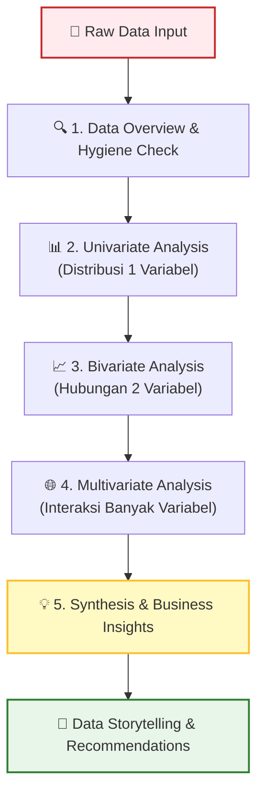
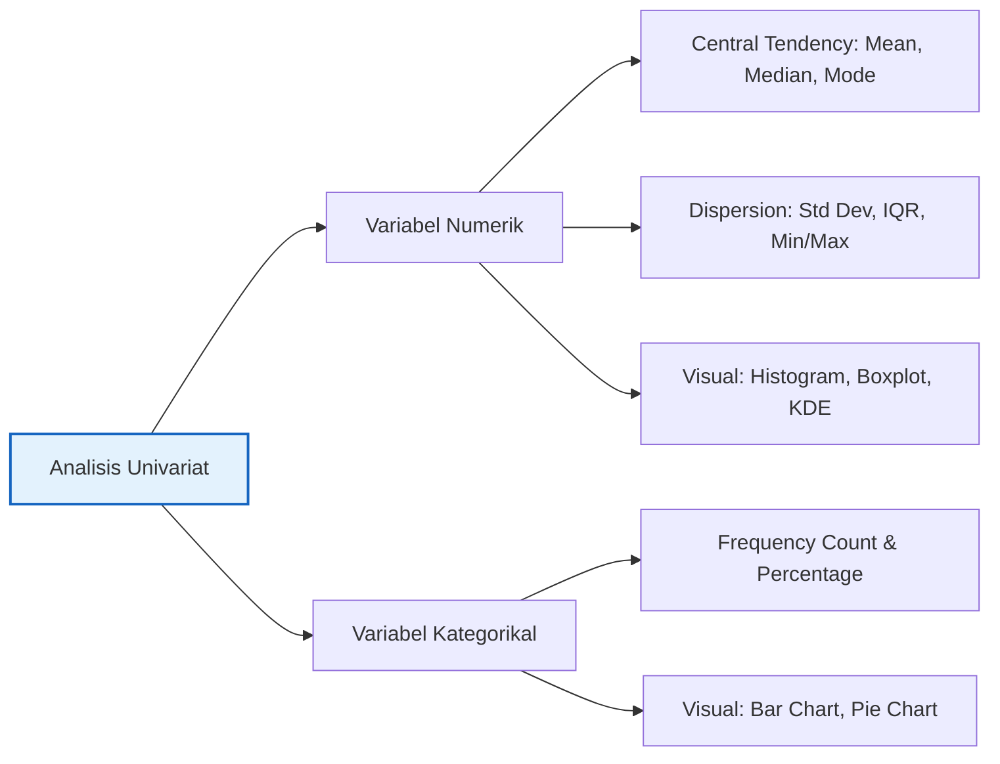
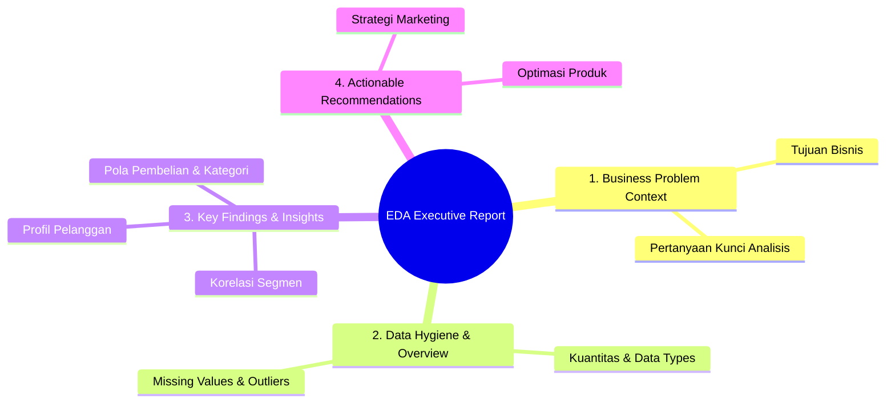

# 📘 Modul 10: Exploratory Data Analysis (EDA)

---

## 🎯 Tujuan Pembelajaran
Setelah menyelesaikan modul ini, Anda diharapkan mampu:
1. Memahami konsep, tujuan, dan alur kerja **Exploratory Data Analysis (EDA)**.
2. Melakukan **Univariate Analysis** untuk memahami karakteristik variabel individual.
3. Melakukan **Bivariate Analysis** untuk menemukan hubungan antarpasangan variabel.
4. Melakukan **Multivariate Analysis** untuk mengungkap interaksi antar-banyak variabel.
5. Menyusun **studi kasus EDA end-to-end** pada dataset e-commerce/retail.
6. Mengenal library **Automated EDA** (`ydata-profiling`, `sweetviz`).

---

## 1. Apa itu Exploratory Data Analysis (EDA)?

**Exploratory Data Analysis (EDA)** adalah proses investigasi awal terhadap data menggunakan statistik deskriptif dan visualisasi grafik untuk menemukan pola, mendeteksi anomali, menguji hipotesis, dan memeriksa asumsi dasar.

> [!NOTE]
> Istilah EDA dipopulerkan oleh matematikawan **John Tukey** (1977) yang menekankan pentingnya mendengarkan "cerita" yang disampaikan oleh data sebelum menerapkan model formal atau inferensi statistik yang rumit.



---

## 2. Alur Kerja EDA Sistematis

### 2.1 Tahap Inspeksi Awal (Data Hygiene)
Sebelum menganalisis hubungan antar variabel, lakukan langkah-langkah dasar kesehatan data:
```python
import pandas as pd
import numpy as np
import matplotlib.pyplot as plt
import seaborn as sns

# Set style visualisasi
sns.set_theme(style="whitegrid")
plt.rcParams['font.size'] = 11

# Example Data Generator (Retail Sales Dataset)
np.random.seed(42)
n_samples = 500

data = pd.DataFrame({
    'CustomerID': [f"CUST-{1000 + i}" for i in range(n_samples)],
    'Age': np.random.randint(18, 65, size=n_samples),
    'Gender': np.random.choice(['Male', 'Female'], size=n_samples, p=[0.48, 0.52]),
    'Category': np.random.choice(['Electronics', 'Clothing', 'Home & Kitchen', 'Books'], size=n_samples),
    'PurchaseAmount': np.round(np.random.exponential(scale=150, size=n_samples) + 20, 2),
    'Rating': np.random.choice([1, 2, 3, 4, 5], size=n_samples, p=[0.05, 0.1, 0.2, 0.4, 0.25]),
    'IsLoyalMember': np.random.choice([0, 1], size=n_samples, p=[0.6, 0.4])
})

# 1. Cek Metadata & Dimensi
print(f"Bentuk Dataset: {data.shape[0]} baris, {data.shape[1]} kolom")
print("\n--- Informast Tipe Data & Missing Values ---")
print(data.info())
print("\n--- 5 Baris Pertama ---")
print(data.head())
```

---

## 3. Univariate Analysis (Analisis Single Variabel)

Analisis univariat berfokus pada **satu variabel pada satu waktu** untuk memahami distribusi, kecenderungan memusat (*central tendency*), dan sebarannya (*dispersion*).



### 3.1 Analisis Variabel Numerik

```python
# Statistik Deskriptif Numerik
print(data[['Age', 'PurchaseAmount']].describe().T)

# Visualisasi Distribusi Numerik: Histogram + KDE + Boxplot
fig, axes = plt.subplots(2, 2, figsize=(14, 10))

# 1. Histogram Age
sns.histplot(data=data, x='Age', kde=True, ax=axes[0, 0], color='#42A5F5', bins=15)
axes[0, 0].set_title("Distribusi Usia Pelanggan", fontweight='bold')

# 2. Boxplot Age
sns.boxplot(data=data, x='Age', ax=axes[0, 1], color='#42A5F5')
axes[0, 1].set_title("Boxplot Usia Pelanggan", fontweight='bold')

# 3. Histogram Purchase Amount (Skewed)
sns.histplot(data=data, x='PurchaseAmount', kde=True, ax=axes[1, 0], color='#66BB6A', bins=20)
axes[1, 0].set_title("Distribusi Total Pembelian (Right-Skewed)", fontweight='bold')

# 4. Boxplot Purchase Amount (Menampilkan Outlier)
sns.boxplot(data=data, x='PurchaseAmount', ax=axes[1, 1], color='#66BB6A')
axes[1, 1].set_title("Boxplot Total Pembelian (Outlier Check)", fontweight='bold')

plt.tight_layout()
plt.show()
```

> [!TIP]
> - Jika data **terdistribusi normal (simetris)**, gunakan **Mean** dan **Standard Deviation**.
> - Jika data **menceng (skewed)** atau memiliki **outlier**, gunakan **Median** dan **Interquartile Range (IQR)**.

### 3.2 Analisis Variabel Kategorikal

```python
# Frekuensi dan Persentase Category
category_freq = data['Category'].value_counts()
category_pct = data['Category'].value_counts(normalize=True) * 100

summary_cat = pd.DataFrame({'Jumlah': category_freq, 'Persentase (%)': category_pct.round(2)})
print(summary_cat)

# Visualisasi Barplot Kategorikal
fig, axes = plt.subplots(1, 2, figsize=(14, 5))

# Bar Chart Kategori Produk
sns.countplot(data=data, x='Category', order=category_freq.index, ax=axes[0], palette='Blues_r')
axes[0].set_title("Jumlah Transaksi per Kategori Produk", fontweight='bold')
for p in axes[0].patches:
    axes[0].annotate(f'{int(p.get_height())}', (p.get_x() + p.get_width() / 2., p.get_height()),
                     ha='center', va='bottom', xytext=(0, 3), textcoords='offset points')

# Pie Chart Gender
data['Gender'].value_counts().plot(kind='pie', autopct='%1.1f%%', ax=axes[1], colors=['#AB47BC', '#26A69A'], startangle=90)
axes[1].set_title("Proporsi Gender Pelanggan", fontweight='bold')
axes[1].set_ylabel('')

plt.tight_layout()
plt.show()
```

---

## 4. Bivariate Analysis (Analisis Dua Variabel)

Analisis bivariat memeriksa **hubungan atau perbedaan antara dua variabel**.

### 4.1 Numerik vs Numerik (Korelasi & Scatter Plot)

```python
# Scatter plot: Age vs Purchase Amount
fig, ax = plt.subplots(figsize=(8, 6))
sns.scatterplot(data=data, x='Age', y='PurchaseAmount', hue='Gender', alpha=0.7, ax=ax)
sns.regplot(data=data, x='Age', y='PurchaseAmount', scatter=False, ax=ax, color='red')

ax.set_title("Hubungan Usia vs Total Pembelian", fontweight='bold')
ax.set_xlabel("Usia (Tahun)")
ax.set_ylabel("Total Pembelian (USD)")
plt.show()

# Hitung nilai korelasi Pearson & Spearman
pearson_corr = data['Age'].corr(data['PurchaseAmount'], method='pearson')
spearman_corr = data['Age'].corr(data['PurchaseAmount'], method='spearman')
print(f"Korelasi Pearson (Age vs Purchase): {pearson_corr:.3f}")
print(f"Korelasi Spearman (Age vs Purchase): {spearman_corr:.3f}")
```

### 4.2 Numerik vs Kategorikal (Perbandingan Group)

```python
# Pembelian berdasarkan Kategori Produk (Groupby Aggregation)
cat_purchases = data.groupby('Category')['PurchaseAmount'].agg(['count', 'mean', 'median', 'std']).reset_index()
print(cat_purchases.round(2))

# Visualisasi Boxplot & Barplot Mean
fig, axes = plt.subplots(1, 2, figsize=(14, 6))

sns.boxplot(data=data, x='Category', y='PurchaseAmount', ax=axes[0], palette='Set2')
axes[0].set_title("Distribsi Pembelian per Kategori", fontweight='bold')

sns.barplot(data=data, x='Category', y='PurchaseAmount', estimator=np.mean, ci=None, ax=axes[1], palette='Set2')
axes[1].set_title("Rata-rata Pembelian per Kategori", fontweight='bold')

plt.tight_layout()
plt.show()
```

### 4.3 Kategorikal vs Kategorikal (Crosstab & Stacked Bar)

```python
# Crosstab Gender vs Category
ct = pd.crosstab(data['Gender'], data['Category'], normalize='index') * 100
print("Proporsi Kategori Produk berdasarkan Gender (%):")
print(ct.round(2))

# Visualisasi Stacked Bar Chart
ct.plot(kind='bar', stacked=True, figsize=(9, 6), colormap='Spectral')
plt.title("Proporsi Preferensi Kategori berdasarkan Gender", fontweight='bold')
plt.ylabel("Persentase (%)")
plt.xlabel("Gender")
plt.legend(title="Category", bbox_to_anchor=(1.05, 1), loc='upper left')
plt.tight_layout()
plt.show()
```

---

## 5. Multivariate Analysis (Analisis > 2 Variabel)

Analisis multivariat mengeksplorasi hubungan kompleks antara tiga atau lebih variabel secara simultan.

### 5.1 Correlation Heatmap Matrix
```python
# Matriks Korelasi variabel numerik
numeric_cols = data.select_dtypes(include=[np.number]).columns
corr_matrix = data[numeric_cols].corr()

plt.figure(figsize=(8, 6))
sns.heatmap(corr_matrix, annot=True, fmt=".2f", cmap='coolwarm', vmin=-1, vmax=1, linewidths=1)
plt.title("Heatmap Matrix Korelasi Numerik", fontweight='bold')
plt.show()
```

### 5.2 FacetGrid / Multi-Panel Visualization
```python
# FacetGrid: Purchase Amount berdasarkan Age, Gender, dan Loyalty Status
g = sns.FacetGrid(data, col="Gender", row="IsLoyalMember", margin_titles=True, height=4, aspect=1.2)
g.map(sns.scatterplot, "Age", "PurchaseAmount", alpha=0.7, color="#1976D2")
g.fig.suptitle("Interaksi: Age vs Purchase Amount berdasarkan Gender & Membership", y=1.03, fontweight='bold')
plt.show()
```

---

## 6. Case Study: End-to-End EDA Report Framework

Dalam dunia kerja nyata, hasil EDA disajikan dalam bentuk struktur laporan analitis yang sistematis:



---

## 7. Automated EDA Tools (`ydata-profiling` & `sweetviz`)

Untuk mempercepat eksplorasi data awal, Anda dapat menggunakan library **Automated EDA**:

```python
# 1. Install Library (Jalankan di Terminal / Notebook):
# pip install ydata-profiling sweetviz

# Contoh Kode penggunaan ydata-profiling:
"""
from ydata_profiling import ProfileReport

profile = ProfileReport(data, title="Profiling Report Dataset Retail", explorative=True)
profile.to_file("eda_report.html")
"""

# Contoh Kode penggunaan Sweetviz:
"""
import sweetviz as sv

report = sv.analyze(data)
report.show_html("sweetviz_report.html")
"""
```

> [!WARNING]
> Automated EDA sangat bagus untuk *quick inspection*, namun **tidak menggantikan** pemahaman konteks bisnis, analisis kritis, dan kustomisasi visualisasi yang spesifik sesuai kebutuhan stakeholder.

---

## 📝 Latihan Mandiri & Tantangan

1. **Dataset Exploration:** Muat dataset bawaan Seaborn `tips` (`sns.load_dataset('tips')`).
2. **Univariate Analysis:** Hitung skewness dan buat boxplot untuk kolom `tip`.
3. **Bivariate Analysis:** Uji apakah persentase tip (`tip / total_bill`) berbeda signifikan antara `smoker` (Ya/Tidak) dan `day` (Hari transaksi).
4. **Insight Reporting:** Tuliskan 3 rekomendasi bisnis sederhana untuk pemilik restoran berdasarkan hasil eksplorasi Anda!

---

- ➡️ **Modul Selanjutnya:** [11. Statistik Deskriptif & Inferensial](11_Statistik_Deskriptif_dan_Inferensial.md)
