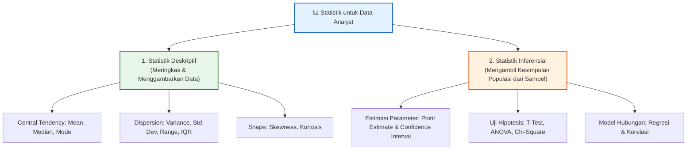
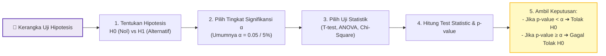

# 📘 Modul 11: Statistik Deskriptif & Inferensial dengan Python

---

## 🎯 Tujuan Pembelajaran
Setelah menyelesaikan modul ini, Anda diharapkan mampu:
1. Memahami perbedaan mendasar antara **Statistik Deskriptif** dan **Statistik Inferensial**.
2. Menghitung dan menginterpretasikan **ukuran pemusatan** dan **penyebaran data**.
3. Memahami **Distribusi Probabilitas** (Distribusi Normal, Z-Score, Central Limit Theorem).
4. Melakukan **Uji Hipotesis** (Hypothesis Testing) dengan menetapkan $H_0$, $H_1$, nilai $\alpha$, dan $p$-value.
5. Mengimplementasikan **Uji Statistik** (T-test, ANOVA, Chi-Square, Korelasi) menggunakan `scipy.stats` dan `statsmodels`.
6. Menghitung dan menginterpretasikan **Confidence Interval (Rentang Kepercayaan)**.

---

## 1. Peta Konsep Statistik untuk Data Analyst

Statistik adalah landasan utama dalam data science untuk mengubah angka mentah menjadi insight ilmiah yang dapat dipertanggungjawabkan.



---

## 2. Statistik Deskriptif

Statistik deskriptif merangkum fitur-fitur utama dari kumpulan data secara kuantitatif.

```python
import numpy as np
import pandas as pd
import scipy.stats as stats
import matplotlib.pyplot as plt
import seaborn as sns

# Dataset Simulasi Gaji (dalam Juta Rupiah)
gaji = np.array([5.5, 6.0, 6.2, 6.5, 7.0, 7.2, 7.5, 8.0, 8.5, 9.0, 12.0, 35.0]) # 35.0 adalah Outlier

# 1. Ukuran Pemusatan (Central Tendency)
mean_gaji = np.mean(gaji)
median_gaji = np.median(gaji)
mode_gaji = stats.mode(gaji, keepdims=True).mode[0]

print(f"Mean Gaji   : Rp {mean_gaji:.2f} Juta")
print(f"Median Gaji : Rp {median_gaji:.2f} Juta")
print(f"Modus Gaji  : Rp {mode_gaji:.2f} Juta")

# 2. Ukuran Penyebaran (Dispersion)
std_gaji = np.std(gaji, ddof=1) # Sample Standard Deviation
var_gaji = np.var(gaji, ddof=1)
iqr_gaji = stats.iqr(gaji)
range_gaji = np.ptp(gaji) # Peak-to-peak (Max - Min)

print(f"\nVariansi           : {var_gaji:.2f}")
print(f"Standar Deviasi    : {std_gaji:.2f}")
print(f"Interquartile (IQR): {iqr_gaji:.2f}")
print(f"Range (Jangkauan)  : {range_gaji:.2f}")

# 3. Shape (Kemiringan Distribusi)
skewness = stats.skew(gaji)
kurtosis = stats.kurtosis(gaji)
print(f"\nSkewness (Kemiringan): {skewness:.2f} (Right-Skewed karena Outlier)")
print(f"Kurtosis             : {kurtosis:.2f}")
```

---

## 3. Distribusi Probabilitas & Central Limit Theorem

### 3.1 Distribusi Normal & Z-Score
Distribusi Normal (Gaussian) berbentuk kurva lonceng simetris yang ditentukan oleh Mean ($\mu$) dan Standar Deviasi ($\sigma$).

$$Z = \frac{X - \mu}{\sigma}$$

```python
# Standarisasi Nilai ke Z-Score
data_val = 8.5
z_score = (data_val - mean_gaji) / std_gaji
print(f"Z-Score untuk nilai {data_val}: {z_score:.2f}")

# Visualisasi Distribusi Normal Standar
x = np.linspace(-4, 4, 1000)
y = stats.norm.pdf(x, 0, 1)

plt.figure(figsize=(9, 5))
plt.plot(x, y, color='#1E88E5', linewidth=2.5, label='Standard Normal Distribution N(0,1)')
plt.fill_between(x, y, where=(x >= -1.96) & (x <= 1.96), color='#64B5F6', alpha=0.4, label='95% Area (-1.96 <= Z <= 1.96)')
plt.title("Distribusi Normal Standar & Area Kepercayaan 95%", fontweight='bold')
plt.xlabel("Z-Score")
plt.ylabel("Probability Density")
plt.legend()
plt.show()
```

### 3.2 Central Limit Theorem (CLT)
CLT menyatakan bahwa jika Anda mengambil banyak sampel acak berukuran $n$ dari populasi manapun, distribusi rata-rata sampel (*sampling distribution of the mean*) akan mendekati **Distribusi Normal** seiring besarnya nilai $n$ ($n \ge 30$).

---

## 4. Kerangka Kerja Uji Hipotesis (Hypothesis Testing)

Uji hipotesis adalah prosedur formal untuk menguji apakah klaim atau dugaan tentang populasi didukung oleh data sampel.



> [!IMPORTANT]
> - **$p$-value** adalah probabilitas memperoleh hasil sampel seekstrem atau lebih ekstrem dari yang diamati jika $H_0$ benar.
> - **Type I Error ($\alpha$):** Menolak $H_0$ padahal $H_0$ benar (*False Positive*).
> - **Type II Error ($\beta$):** Gagal menolak $H_0$ padahal $H_0$ salah (*False Negative*).

---

## 5. Implementasi Uji Statistik Populer di Python

### 5.1 Student's t-Test (Uji Beda Rata-Rata)

#### A. One-Sample t-Test
Menguji apakah rata-rata sampel berbeda signifikan dari nilai standar populasi tertentu.
```python
# Masalah: Apakah rata-rata jam kerja karyawan (sampel) berbeda dari standar 40 jam/minggu?
jam_kerja = [42, 44, 38, 41, 45, 39, 43, 40, 46, 42, 41, 43]
target_populasi = 40

t_stat, p_val = stats.ttest_1samp(jam_kerja, popmean=target_populasi)

print(f"One-Sample t-Test -> t-stat: {t_stat:.3f}, p-value: {p_val:.4f}")
if p_val < 0.05:
    print("Kesimpulan: Tolak H0 (Rata-rata jam kerja berbeda signifikan dari 40 jam).")
else:
    print("Kesimpulan: Gagal Tolak H0 (Tidak ada perbedaan signifikan).")
```

#### B. Independent Two-Sample t-Test (A/B Testing)
Menguji apakah rata-rata dua kelompok independen (misal: Kelompok Control A vs Kelompok Variant B) berbeda signifikan.
```python
# A/B Testing Conversions Rate (Jumlah Pembelian)
group_A = np.random.normal(loc=150, scale=25, size=100) # Design A
group_B = np.random.normal(loc=162, scale=28, size=100) # Design B

t_stat, p_val = stats.ttest_ind(group_A, group_B)

print(f"\nTwo-Sample t-Test -> t-stat: {t_stat:.3f}, p-value: {p_val:.4f}")
if p_val < 0.05:
    print("Kesimpulan: Tolak H0 (Design B memberikan hasil penjualan yang berbeda signifikan dibanding Design A).")
else:
    print("Kesimpulan: Gagal Tolak H0.")
```

#### C. Paired Sample t-Test
Menguji dua pengukuran pada kelompok yang sama sebelum dan sesudah perlakuan (*Before vs After*).
```python
before_training = [65, 70, 60, 75, 80, 72, 68, 74]
after_training  = [78, 82, 71, 84, 88, 81, 79, 85]

t_stat, p_val = stats.ttest_rel(before_training, after_training)
print(f"\nPaired t-Test -> t-stat: {t_stat:.3f}, p-value: {p_val:.4f}")
```

---

### 5.2 One-Way ANOVA (Analysis of Variance)
Menguji perbedaan rata-rata antara **tiga atau lebih kelompok**.

```python
# Membandingkan performa penjualan di 3 Cabang Toko
cabang_1 = [120, 135, 110, 125, 130]
cabang_2 = [145, 150, 160, 155, 140]
cabang_3 = [95, 100, 105, 90, 110]

f_stat, p_val = stats.f_oneway(cabang_1, cabang_2, cabang_3)

print(f"One-Way ANOVA -> F-stat: {f_stat:.3f}, p-value: {p_val:.4f}")
if p_val < 0.05:
    print("Kesimpulan: Terdapat setidaknya satu cabang yang rata-rata penjuallannya berbeda secara signifikan.")
```

---

### 5.3 Chi-Square Test of Independence ($\chi^2$)
Menguji hubungan/independensi antara **dua variabel kategorikal**.

```python
# Contingency Table: Preferensi Metode Pembayaran berdasarkan Generasi
# Rows: Gen Z, Millennial | Cols: E-Wallet, Credit Card, Cash
contingency_table = [
    [120, 30, 10],  # Gen Z
    [80,  70, 50]   # Millennial
]

chi2_stat, p_val, dof, expected = stats.chi2_contingency(contingency_table)

print(f"Chi-Square Test -> Chi2-stat: {chi2_stat:.3f}, p-value: {p_val:.4f}, Degree of Freedom: {dof}")
if p_val < 0.05:
    print("Kesimpulan: Terdapat hubungan/asosiasi yang signifikan antara Generasi dan pilihan Metode Pembayaran.")
```

---

## 6. Confidence Interval (Rentang Kepercayaan)

Confidence Interval (CI) memberikan rentang nilai di mana parameter populasi sejati diperkirakan berada dengan tingkat kepercayaan tertentu (misalnya 95%).

```python
data_sample = np.array([24.5, 26.1, 23.8, 25.4, 27.2, 24.9, 25.8, 26.5, 24.1, 25.0])
confidence = 0.95
n = len(data_sample)
mean = np.mean(data_sample)
sem = stats.sem(data_sample) # Standard Error of the Mean

ci = stats.t.interval(confidence, df=n-1, loc=mean, scale=sem)

print(f"Sample Mean: {mean:.2f}")
print(f"95% Confidence Interval untuk Rata-Rata Populasi: ({ci[0]:.2f}, {ci[1]:.2f})")
```

---

## 💡 Panduan Memilih Uji Statistik yang Tepat

| Jenis Data / Jumlah Kelompok | Tujuan Analisis | Uji Statistik yang Tepat | Fungsi Python (`scipy.stats`) |
|:---|:---|:---|:---|
| 1 Sampel Numerik vs Standar | Uji beda rata-rata dengan nilai target | One-Sample t-Test | `ttest_1samp()` |
| 2 Kelompok Numerik Independen | Uji beda rata-rata 2 grup independen | Independent t-Test | `ttest_ind()` |
| 2 Kelompok Numerik Berpasangan | Uji beda Sebelum vs Sesudah | Paired Sample t-Test | `ttest_rel()` |
| $\ge 3$ Kelompok Numerik | Uji beda rata-rata multi-grup | One-Way ANOVA | `f_oneway()` |
| 2 Variabel Kategorikal | Uji hubungan / asosiasi | Chi-Square Test | `chi2_contingency()` |
| 2 Variabel Numerik (Normal) | Ukur kekuatan hubungan linier | Pearson Correlation | `pearsonr()` |
| 2 Variabel Numerik/Ordinal (Non-Normal) | Ukur kekuatan hubungan monotonik | Spearman Rank Correlation | `spearmanr()` |

---

## 📝 Latihan Mandiri & Tantangan

1. **A/B Testing Analysis:** Buatlah dua array numpy acak yang mensimulasikan rata-rata durasi sesi pengguna aplikasi pada Versi Lama (mean=4.2 min) dan Versi Baru (mean=4.8 min). Lakukan Independent t-test dan tentukan apakah Versi Baru meningkatkan engagement secara signifikan!
2. **Uji Asosiasi Kategorikal:** Kumpulkan data frekuensi pembelian (Online vs Offline) berdasarkan Gender. Gunakan Chi-Square Test untuk menguji independensinya!

---

- ➡️ **Modul Selanjutnya:** [12. Proyek Portofolio & Best Practices](12_Proyek_Portofolio_dan_Best_Practices.md)
