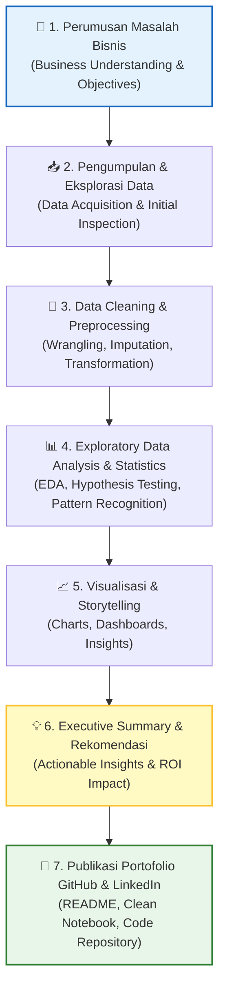

# 📘 Modul 12: Proyek Portofolio End-to-End & Best Practices

---

## 🎯 Tujuan Pembelajaran
Setelah menyelesaikan modul ini, Anda diharapkan mampu:
1. Menyusun proyek analisis data **End-to-End** dari perumusan masalah hingga rekomendasi bisnis.
2. Mengubah Jupyter Notebook eksploratif menjadi **skrip Python yang bersih, modular, dan terstruktur** sesuai standar `PEP 8`.
3. Mengelola repositori **Git & GitHub** untuk portofolio analisis data profesional.
4. Menulis **README Repositori** dan **Executive Summary** yang menarik minat recruiter.
5. Mempersiapkan diri menghadapi **Technical Interview** dan **Live Coding Challenge** untuk posisi Data Analyst.

---

## 1. Anatomi Proyek Data Analyst End-to-End

Proyek portofolio yang berkualitas tinggi tidak hanya menampilkan kode yang berjalan, melainkan **alur pemikiran analitis (*analytical mindset*)** dari awal hingga akhir.



---

## 2. Struktur Standar Repositori Proyek Data Analyst

Repositori GitHub portofolio Anda harus rapi dan mudah dinavigasi oleh *recruiter* atau *lead data analyst*:

```text
my-data-analyst-portfolio/
│
├── data/
│   ├── raw/                 # Data asli yang tidak diubah (read-only)
│   └── processed/           # Data hasil cleaning & preprocessing
│
├── notebooks/
│   ├── 01_data_cleaning.ipynb
│   ├── 02_exploratory_analysis.ipynb
│   └── 03_hypothesis_testing.ipynb
│
├── src/                     # Skrip Python modular
│   ├── __init__.py
│   ├── data_loader.py       # Fungsi load & ingest data
│   ├── cleaner.py           # Fungsi data preprocessing
│   └── visualization.py     # Custom plotting helpers
│
├── reports/
│   ├── figures/             # Gambar/grafik ter-export
│   └── executive_summary.pdf
│
├── .gitignore               # Mengabaikan file temp/virtualenv/data besar
├── requirements.txt         # Daftar dependency library
└── README.md                # Dokumentasi utama proyek portofolio
```

---

## 3. Best Practices Writing Clean Python Code

### 3.1 Gunakan Functions & Modular Code (Bukan Monolithic Code)
Hindari menulis ratusan baris kode berulang di Notebook tanpa fungsi.

```python
# ❌ BURUK: Kode monolitik berulang-ulang
import pandas as pd

df = pd.read_csv("data.csv")
df['age'] = df['age'].fillna(df['age'].median())
df['salary'] = df['salary'].fillna(df['salary'].mean())

# ✅ BAIK: Membuat fungsi modular yang teruji dan bersih
import pandas as pd
from typing import Dict, Any

def handle_missing_values(df: pd.DataFrame, strategy_map: Dict[str, str]) -> pd.DataFrame:
    """
    Membersihkan missing values berdasarkan strategi per kolom.
    
    Args:
        df: DataFrame input
        strategy_map: Kamus strategi, contoh: {'age': 'median', 'salary': 'mean'}
        
    Returns:
        DataFrame yang sudah dibersihkan
    """
    df_clean = df.copy()
    for column, strategy in strategy_map.items():
        if column in df_clean.columns:
            if strategy == 'median':
                df_clean[column] = df_clean[column].fillna(df_clean[column].median())
            elif strategy == 'mean':
                df_clean[column] = df_clean[column].fillna(df_clean[column].mean())
            elif strategy == 'mode':
                df_clean[column] = df_clean[column].fillna(df_clean[column].mode()[0])
    return df_clean
```

### 3.2 Efisiensi Memori (Optimasi Tipe Data Pandas)
Untuk dataset berukuran besar, optimalkan tipe data untuk menghemat RAM hingga 70-80%:

```python
def optimize_memory(df: pd.DataFrame) -> pd.DataFrame:
    """Mengonversi tipe data numerik dan objek ke bentuk yang efisien memori."""
    df_opt = df.copy()
    for col in df_opt.select_dtypes(include=['int64']).columns:
        df_opt[col] = pd.to_numeric(df_opt[col], downcast='integer')
    for col in df_opt.select_dtypes(include=['float64']).columns:
        df_opt[col] = pd.to_numeric(df_opt[col], downcast='float')
    for col in df_opt.select_dtypes(include=['object']).columns:
        if df_opt[col].nunique() / len(df_opt[col]) < 0.5:
            df_opt[col] = df_opt[col].astype('category')
    return df_opt
```

---

## 4. Alur Kerja Git & GitHub untuk Portofolio

### 4.1 Commands Dasar Git untuk Data Analyst
```bash
# 1. Inisialisasi Repositori Lokal
git init

# 2. Tambahkan File ke Staging Area
git add README.md notebooks/ src/ requirements.txt

# 3. Commit Perubahan dengan Pesan yang Jelas
git commit -m "feat: Add EDA notebook and clean pipeline script"

# 4. Hubungkan ke Remote GitHub & Push
git remote add origin https://github.com/username/retail-sales-analysis.git
git branch -M main
git push -u origin main
```

---

## 5. Template README Repositori GitHub Berstandar Industri

Gunakan template README berikut agar repositori Anda terlihat sangat profesional:

```markdown
# 📊 Retail Customer Churn & Revenue Optimization Analysis

## 🎯 Executive Summary
Proyek ini menganalisis dataset e-commerce berisi **50.000+ transaksi** untuk mengidentifikasi faktor utama penyebab peninggalan pelanggan (*churn*) dan memberikan rekomendasi strategi retensi berbasis data.

### 🔑 Key Business Findings
- **Tingkat Churn:** Pelanggan yang tidak bertransaksi dalam 90 hari terakhir mencapai **32.4%**.
- **Sensitivitas Diskon:** Pelanggan di segmen *Clothing* 2.5x lebih sensitif terhadap diskon promo dibanding segmen *Electronics*.
- **Metode Pembayaran:** Pengguna metode pembayaran *Cash on Delivery (COD)* memiliki risiko churn 45% lebih tinggi dibanding *E-Wallet*.

---

## 🛠️ Tech Stack & Library
- **Bahasa:** Python 3.11+
- **Data Wrangling & Analysis:** Pandas, NumPy, SciPy
- **Visualisasi:** Matplotlib, Seaborn
- **Environment & Versioning:** Jupyter Notebook, Git, GitHub

---

## 🚀 Cara Menjalankan Proyek
1. Clone repositori ini:
   ```bash
   git clone https://github.com/username/retail-sales-analysis.git
   cd retail-sales-analysis
   ```
2. Buat virtual environment & install dependencies:
   ```bash
   python -m venv venv
   source venv/bin/activate  # Windows: venv\Scripts\activate
   pip install -r requirements.txt
   ```
3. Buka Notebook:
   ```bash
   jupyter notebook notebooks/02_exploratory_analysis.ipynb
   ```

---

## 💡 Rekomendasi Bisnis
1. **Automated Re-engagement Campaign:** Kirimkan voucher personalized e-wallet untuk pengguna inactive di hari ke-60.
2. **Optimasi Pembayaran COD:** Berikan insentif *cashback* 5% untuk migrasi pengguna COD ke E-Wallet.
```

---

## 6. Persiapan Interview Kerja Data Analyst (Technical & Storytelling)

### 6.1 Tipe Pertanyaan Technical Python & SQL
1. **Pandas Performance:** "Bagaimana cara mempercepat agregasi data 10 juta baris di Pandas?"  
   *Jawaban:* Gunakan vectorization, hindari iterasi `iterrows()`, konversi kolom string ke `category`, atau manfaatkan library paralel seperti `Polars` / `Dask`.
2. **Missing Values:** "Kapan Anda memilih meng-drop missing value vs melakukan imputasi?"  
   *Jawaban:* Jika rasio missing < 5% dan acak (MCAR), drop bisa dilakukan. Jika > 5% atau memiliki pola (MAR/MNAR), imputasi dengan median/mode atau model prediktif lebih tepat.
3. **Statistical Significance:** "Bagaimana cara Anda menjelaskan nilai $p$-value 0.03 kepada Manajer Bisnis non-teknis?"  
   *Jawaban:* "Hanya ada 3% kemungkinan bahwa perbedaan penjualan ini terjadi secara kebetulan semata. Jadi, kita 97% yakin bahwa strategi baru ini memang benar-benar efektif."

### 6.2 Framework STAR untuk Presentasi Portofolio
Saat mempresentasikan proyek portofolio Anda di hadapan tim interviewer, gunakan metode **STAR**:
- **Situation (S):** Jelaskan latar belakang masalah bisnis yang dihadapi perusahaan.
- **Task (T):** Jelaskan peran dan pertanyaan spesifik yang harus Anda jawab.
- **Action (A):** Uraikan teknik Python, EDA, cleaning, dan uji statistik yang Anda terapkan.
- **Result (R):** Jelaskan dampak kuantitatif, insight utama, dan rekomendasi aksi bisnis yang Anda hasilkan.

---

## ✅ Checklist Kesiapan Portofolio Data Analyst

- [ ] Memiliki minimal 2-3 proyek portofolio end-to-end berdedikasi di GitHub.
- [ ] Setiap repositori dilengkapi `README.md` yang jelas, visualisasi menarik, dan kesimpulan bisnis.
- [ ] Kode Python di notebook terstruktur rapi, ber-Fungsi, dan memiliki komentar/markdown penjelas.
- [ ] Memiliki profil LinkedIn yang menyantumkan link repositori GitHub dan ringkasan skill utama.
- [ ] Menguasai SQL dasar-hingga-lanjutan (JOIN, GroupBy, Window Functions) berdampingan dengan Python Pandas.

---

🎉 **Selamat! Anda telah menyelesaikan seluruh Kurikulum Pembelajaran Python untuk Data Analyst dari Dasar hingga Siap Kerja!**
