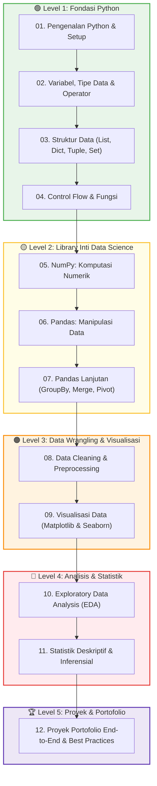

# 🐍 Kurikulum Lengkap & Roadmap Belajar Python untuk Data Analyst

Selamat datang di **Jalur Belajar (Learning Path) Python untuk Data Analyst**!  
Materi ini dirancang secara bertahap (*step-by-step*) mulai dari nol (pemula) hingga tingkat mahir (*advanced*) untuk mempersiapkan Anda menjadi seorang **Data Analyst** yang kompeten menggunakan Python sebagai alat utama analisis data.

---

## 🧭 Peta Belajar (Curriculum Roadmap)



---

## 📚 Daftar Modul Pembelajaran

| No | Modul | Fokus Materi Utama | Tingkat |
|:---:|:---|:---|:---:|
| 1 | [01. Pengenalan Python & Setup](01_Pengenalan_Python_dan_Setup.md) | Mengapa Python untuk DA, instalasi Anaconda/VS Code, Jupyter Notebook, `pip`, virtual environment. | Pemula |
| 2 | [02. Variabel, Tipe Data & Operator](02_Variabel_Tipe_Data_dan_Operator.md) | Variabel, tipe data primitif (`int`, `float`, `str`, `bool`), casting, operator aritmatika/logika, f-string. | Pemula |
| 3 | [03. Struktur Data](03_Struktur_Data_List_Dict_Tuple_Set.md) | List, Dictionary, Tuple, Set, indexing, slicing, list comprehension, nested structures. | Pemula |
| 4 | [04. Control Flow & Fungsi](04_Control_Flow_dan_Fungsi.md) | `if/elif/else`, `for`, `while`, `break/continue`, fungsi `def`, `lambda`, `*args/**kwargs`, scope. | Pemula - Menengah |
| 5 | [05. NumPy: Komputasi Numerik](05_NumPy_Komputasi_Numerik.md) | `ndarray`, broadcasting, vectorization, indexing, operasi statistik, reshape, random. | Menengah |
| 6 | [06. Pandas: Manipulasi Data](06_Pandas_Manipulasi_Data.md) | `Series`, `DataFrame`, `read_csv/excel`, filtering, `loc/iloc`, sorting, handling missing values. | Menengah |
| 7 | [07. Pandas Lanjutan](07_Pandas_Lanjutan_GroupBy_Merge_Pivot.md) | `groupby()`, `agg()`, `merge()`, `concat()`, `pivot_table()`, `melt()`, `apply()`, `map()`. | Menengah - Mahir |
| 8 | [08. Data Cleaning & Preprocessing](08_Data_Cleaning_dan_Preprocessing.md) | Handling nulls, duplikasi, outlier (IQR/Z-score), encoding, normalisasi, regex, data pipeline. | Menengah - Mahir |
| 9 | [09. Visualisasi Data](09_Visualisasi_Data_Matplotlib_Seaborn.md) | Matplotlib (`figure`, `axes`, `subplot`), Seaborn (heatmap, pairplot, boxplot), customization & styling. | Menengah - Mahir |
| 10 | [10. Exploratory Data Analysis (EDA)](10_EDA_Exploratory_Data_Analysis.md) | Alur EDA sistematis, univariate/bivariate/multivariate analysis, profiling, storytelling dengan data. | Mahir |
| 11 | [11. Statistik Deskriptif & Inferensial](11_Statistik_Deskriptif_dan_Inferensial.md) | Mean, median, std, distribusi, korelasi, hypothesis testing (t-test, chi-square), confidence interval. | Mahir |
| 12 | [12. Proyek Portofolio & Best Practices](12_Proyek_Portofolio_dan_Best_Practices.md) | End-to-end project, Jupyter best practices, Git untuk DA, struktur portofolio GitHub, interview prep. | Siap Kerja |

### 📖 Dokumen Referensi Cepat (Cheatsheets)
- [Pandas Cheatsheet](Pandas_Cheatsheet.md) - Sintaks, metode terpenting, dan pola umum Pandas.
- [NumPy Cheatsheet](NumPy_Cheatsheet.md) - Operasi array, fungsi matematika, dan teknik broadcasting.

### 📝 Ujian Evaluasi & Test Kemampuan
- [Ujian Evaluasi Technical Assessment](EXAM_TECHNICAL_ASSESSMENT_PYTHON.md) - 20 Soal PG, 5 Soal Debugging Kode, dan 1 Studi Kasus Coding Hands-on.
- [Kunci Jawaban & Solusi Skrip Python](KUNCI_JAWABAN_DAN_SOLUSI_TEST.md) - Pembahasan lengkap jawaban bagian A, B, dan script solusi bagian C.

---

## 🛠️ Persiapan & Setup Lingkungan Belajar

Sebelum memulai Modul 1, pastikan Anda telah menyiapkan:

1. **Python 3.10+ (atau lebih baru)**:
   - **Opsi A (Disarankan):** Instal [Anaconda Distribution](https://www.anaconda.com/download) — sudah termasuk Python, Jupyter Notebook, NumPy, Pandas, Matplotlib, Seaborn, dan 250+ library data science.
   - **Opsi B:** Instal [Python resmi](https://www.python.org/downloads/) lalu instal library secara manual via `pip`.

2. **Editor / IDE**:
   - **Jupyter Notebook / JupyterLab** — Standar industri untuk eksplorasi dan analisis data interaktif.
   - **Visual Studio Code** — Dengan ekstensi Python dan Jupyter untuk pengalaman coding yang lebih kaya.
   - **Google Colab** — Alternatif gratis berbasis cloud, tanpa instalasi lokal.

3. **Library Utama yang Dibutuhkan**:
   ```bash
   pip install numpy pandas matplotlib seaborn scipy openpyxl
   ```

4. **Verifikasi Instalasi**:
   ```python
   import numpy as np
   import pandas as pd
   import matplotlib.pyplot as plt
   import seaborn as sns

   print(f"NumPy: {np.__version__}")
   print(f"Pandas: {pd.__version__}")
   print("✅ Semua library siap digunakan!")
   ```

---

## 🎯 Tips Sukses Belajar

> [!TIP]
> 1. **Ketik Sendiri, Jangan Copy-Paste:** Membangun *muscle memory* coding jauh lebih efektif daripada membaca pasif.
> 2. **Eksplorasi dengan Dataset Nyata:** Setelah memahami teori, coba terapkan langsung pada dataset dari Kaggle, BPS, atau data perusahaan.
> 3. **Pahami Error Message:** Pesan error Python sangat informatif — baca dari bawah ke atas (*traceback*) untuk menemukan akar masalah.
> 4. **Bangun Portofolio di GitHub:** Dokumentasikan setiap proyek analisis Anda dengan README yang jelas dan notebook yang rapi.
> 5. **Lanjutkan ke Proyek Ujian:** Setelah menyelesaikan seluruh modul, kerjakan proyek end-to-end di Modul 12 untuk menguji penguasaan materi Anda!
